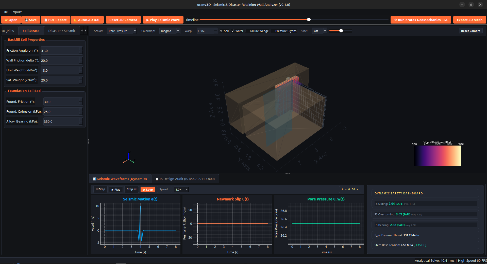
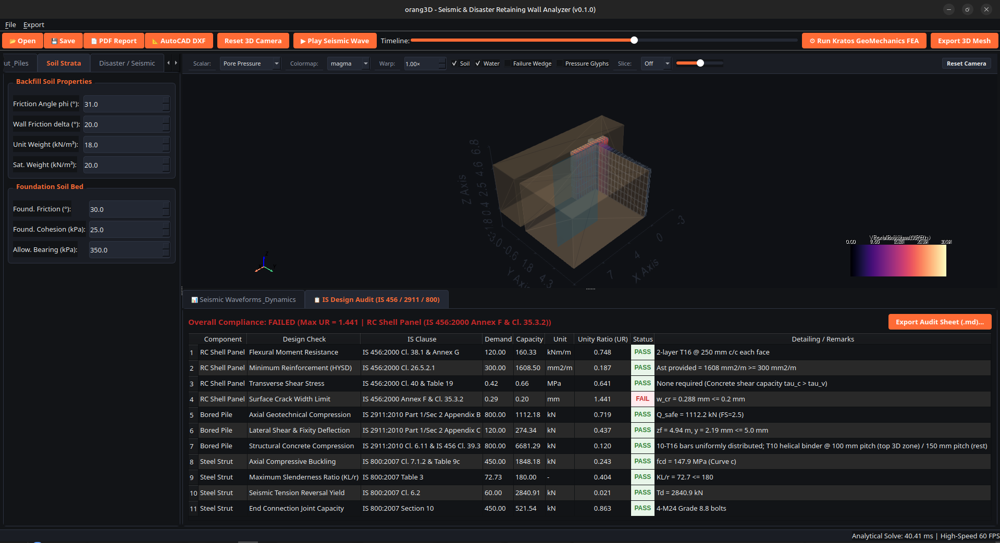

# orang3D 🍊🧱

**Real-Time 3D Seismic, Hydrodynamic, Geotechnical SSI, and Structural Code Design for Retaining Systems**

[](https://www.python.org/downloads/)
[](https://www.qt.io/)
[](https://docs.pyvista.org/)
[](https://bis.gov.in/)
[](tests/)
[](tests/)
[](LICENSE)

`orang3D` is a free, 100% open-source scientific desktop engineering application designed for civil, structural, and geotechnical engineers and researchers. It evaluates the physical stability, structural integrity, and dynamic response of retaining wall systems under earthquake ground shaking, rising groundwater tables, rainfall infiltration, and backfill liquefaction.

Built with a **Multi-Tier Physics Architecture**, it pairs a **sub-millisecond vectorized analytical core (< 1 ms @ 60 FPS)** and an **AI/PINN surrogate (< 0.2 ms)** with high-fidelity scientific 3D visualization, automated AutoCAD DXF detailing, and regulatory Indian Standards (IS Code) auditing.

> 📘 **New to orang3D? Jump straight into the guide:**  
> Follow the **[Comprehensive Simulation Guide](docs/SIMULATION_GUIDE.md)** for step-by-step walkthroughs from static cantilever sizing to real-time earthquake wave playback, Indian Standards compliance auditing, and AutoCAD DXF export.

---

## 📸 Application Showcase

### Main View: 3D Scientific Viewport & Dynamic Waveform Dashboard


### Regulatory Compliance: Live Indian Standards (IS 456 / 2911 / 800) Audit


---

## 🧭 Understanding the User Interface: How to Read & Use It

At first glance, the interface can look complex, but it is organized into **4 simple functional zones**:

```
+--------------------------------------------------------------------------------------------------+
| 1. TOP BAR: ACTION CONTROLS  (Play Earthquake, Run FEA, Export CAD/PDF)                         |
+---------------------------------------------------+----------------------------------------------+
| 2. LEFT SIDEBAR: INPUTS                           | 3. 3D VIEWPORT: THE PHYSICAL REALITY         |
|    (Wall Dimensions, Soil Strata, Disaster)       |    (Wall, Soil Block, Water Table)           |
+---------------------------------------------------+----------------------------------------------+
| 4. BOTTOM TABS: THE ENGINEERING VERDICT (Safety Badges, Waveforms & IS Code Checklist)         |
+--------------------------------------------------------------------------------------------------+
```

### 1. The 3D Center Viewport (What You Are Seeing)
- **The Colored T-Shape in the Center:** This is the **reinforced concrete retaining wall** (stem standing up, base footing lying flat). Its surface colors show stress concentrations or pore pressure (e.g., using the `magma` or `viridis` colormap).
- **The Brown Transparent Blocks:** That is the **earth/soil**! The block on the right is the backfill pushing against the wall; the block below is the foundation bed.
  - *Tip:* Uncheck the **`Soil`** checkbox in the viewport toolbar anytime you want an unobstructed view of the wall.
- **The Blue Translucent Sheet:** That is the underground **water table** inside the hill.
  - *Tip:* Uncheck the **`Water`** checkbox to visualize completely dry conditions.
- **Mouse Navigation:**
  - **Left-Click + Drag:** Orbit / rotate 3D camera.
  - **Scroll Wheel:** Zoom in and out.
  - **Reset Camera:** Click the button on the top-right of the viewport if you ever lose your orientation.

### 2. The Left Sidebar (Your Inputs)
This is your project control panel organized into 5 tabs:
- **`Cantilever Wall`:** Set wall height, stem thickness, toe width, heel width, and shear key dimensions.
- **`Curved Shell`:** Configure cylindrical shell panels, curvature radius $R$, bay span $L_{\text{bay}}$, and vertical piers.
- **`Strut & Piles`:** Adjust bored pile diameter $D_p$, embedment depth $L_{\text{pile}}$, rock socketing, and raking steel struts.
- **`Soil Strata`:** Enter soil internal friction angle ($\phi$), unit weight ($\gamma$), and subgrade bearing capacity.
- **`Disaster / Seismic`:** Dial in earthquake shaking intensity ($k_h, k_v$), water table depth, or liquefaction ratio ($r_u$).

*Every adjustment updates the 3D model and stability calculations in real time (< 1 ms).*

### 3. The Bottom Dashboard (The Engineering Verdict)
The lower panel has two tabs that tell you whether your retaining structure is safe:

#### Tab A: `📊 Seismic Waveforms & Dynamics`
- **Left (Three Waveform Plots):**
  1. **Ground Acceleration $a(t)$ (Cyan):** Shows the incoming earthquake shockwave.
  2. **Newmark Slip $u(t)$ (Orange):** Shows the permanent downhill sliding displacement of the wall. If this line stays flat at $0\text{ cm}$, the wall did not slide! If the earthquake exceeds the wall's sliding capacity, it steps upward.
  3. **Pore Pressure $u_w(t)$ (Green):** Shows dynamic water pressure rising in the soil.
- **Right (Dynamic Safety Dashboard):**
  - **`FS Sliding`**, **`FS Overturning`**, and **`FS Bearing`**: Traffic-light color badges:
    - 🟢 **`[SAFE]` (Green):** Capacity exceeds code requirements.
    - 🟡 **`[MARGINAL]` (Yellow):** Operating close to allowable limits.
    - 🔴 **`[FAIL]` (Red):** The wall is unstable or actively failing.
  - **`P_ae Dynamic Thrust`:** Total instantaneous horizontal push force.
  - **`Stem Base Tension`:** Tensile bending stress in the concrete stem. Displays **`[ELASTIC]`** when intact or flashes **`[CRACKED]`** when micro-cracks form.

#### Tab B: `📋 IS Design Audit (IS 456 / 2911 / 800)`
- A full 9-column regulatory compliance matrix checking flexure, shear, crack width, bored pile fixity, and strut buckling against Indian Standards.
- Displays demand, capacity, and demand-to-capacity Unity Ratios ($\text{UR} \le 0.90 \implies \text{PASS}$).
- Includes a 1-click button: **`Export Audit Sheet (.md)...`** to save formal calculation sheets.

### 4. The Top Toolbar (The Action Controls)
- **`▶ Play Seismic Wave`:** Starts a 60 FPS real-time earthquake playback. The yellow playhead sweeps across the charts while the 3D wall flexes and slides forward.
- **`📐 AutoCAD DXF`:** Exports layered AutoCAD `.dxf` construction drawings ready for drafting.
- **`📄 PDF Report`:** Generates a multi-page geotechnical calculation report with diagrams and pass/fail tables.
- **`⚙ Run Kratos GeoMechanics FEA`:** Launches multi-threaded dynamic Soil-Structure Interaction finite element analysis in the background without freezing the UI.

---

## ⚡ 3-Minute Quick Start

```bash
# 1. Clone repository
git clone https://github.com/dibs/orang3d.git
cd orang3d

# 2. Activate virtual environment & install dependencies
python3 -m venv .venv
source .venv/bin/activate
pip install -r requirements.txt

# 3. Launch the application
python main.py
```

### Try These 3 Actions in the UI:
1. **Watch an Earthquake Live:** Click **`▶ Play Seismic Wave`** in the top toolbar to see the wall deform and watch permanent slip accumulate on the orange chart.
2. **Simulate a Failure:** Go to the **`Disaster / Seismic`** tab on the left and set **Horizontal PGA ($k_h$)** to `0.45 g`. Watch the safety badges turn **RED `[FAIL]`** and the sliding plot jump up.
3. **Export Blueprints:** Click **`📐 AutoCAD DXF`** on the top toolbar to generate a 4-layer CAD drawing complete with rebar detailing and title block.

---

## 🔬 Multi-Tier Physics & Engineering Architecture

```
                      ┌───────────────────────────────────────┐
                      │             orang3D GUI               │
                      │         (PySide6 / Qt 6)              │
                      └──────────────────┬────────────────────┘
                                         │
                 ┌───────────────────────┴───────────────────────┐
                 ▼                                               ▼
   ┌───────────────────────────┐                   ┌───────────────────────────┐
   │    3D Viewport Widget     │                   │     2D Plotting Widget    │
   │  (PyVista + pyvistaqt)    │                   │        (PyQtGraph)        │
   │ • Wall & Soil Strata      │                   │ • Dynamic Accel a(t)      │
   │ • Stress Heatmaps         │                   │ • Newmark Permanent Slip  │
   │ • Water Table Plane       │                   │ • Real-time Safety Badges │
   └─────────────▲─────────────┘                   └─────────────▲─────────────┘
                 │                                               │
                 └───────────────────────┬───────────────────────┘
                                         │
        ┌────────────────────────────────┼────────────────────────────────┐
        ▼                                ▼                                ▼
  ┌───────────┐                    ┌───────────┐                    ┌───────────┐
  │Analytical │                    │ AI / PINN │                    │Deep Kratos│
  │Engine <1ms│                    │ Surrogate │                    │  FEA SSI  │
  │ • M-O     │                    │ • <0.2 ms │                    │ • Dynamic │
  │ • Arching │                    │ • ∑Fx = 0 │                    │ • U-P SSI │
  │ • Newmark │                    │ • UQ / MC │                    │ • Damping │
  └───────────┘                    └───────────┘                    └───────────┘
```

1. **Analytical Core (< 1 ms @ 60 FPS):**
   - **Mononobe-Okabe (1929) & Seed-Whitman (1970):** Dynamic active earth thrust $P_{ae}$ with dynamic height partitioning ($0.33H \to 0.58H$).
   - **Modified Terzaghi/Handy (1985) Horizontal Arching:** 3D cylindrical shell arching reducing lateral pressure by $30\% - 65\%$ between rigid piers.
   - **Newmark (1965) Numerical Sliding:** Double integration of accelerograms for permanent downhill slip $u(t)$.
   - **Meyerhof, Hansen, and Vesic Bearing Capacity:** Dynamic tilt inclination, eccentricity $e \le B/6$, and contact pressure trapezoids.
2. **AI / PINN Fast Surrogates & Uncertainty Quantification (< 0.2 ms):**
   - Physics-Informed Neural Network (PINN) forward pass with horizontal equilibrium projection ($\sum F_x = 0$).
   - Latin Hypercube Sampling (LHS) with Kolmogorov-Smirnov uniformity verification.
   - Monte Carlo reliability analysis: Cornell reliability index $\beta$ and failure probability $P_f$.
   - Monotonic HAZUS-calibrated seismic fragility curves (Slight, Moderate, Extensive, Collapse).
3. **Nonlinear Soil-Structure Interaction (BNWF via OpenSeesPy):**
   - Beam on Nonlinear Winkler Foundation (BNWF) modeling pile-soil contact.
   - Matlock soft-clay and API sand $p-y$ lateral springs, Mosher $t-z$ skin friction, $q-z$ end bearing.
   - Broms lateral pile capacity and minimum embedment depth calculation.
4. **Deep Continuum SSI (Kratos GeoMechanics FEA):**
   - Coupled hydromechanical $u-p$ dynamic continuum FEA running on a multi-threaded background worker thread.
   - Lysmer-Kuhlemeyer radiation damping absorbing boundaries preventing wave reflection box artifacts.
5. **Regulatory Design Standards (IS Codes):**
   - **IS 456:2000:** Limit state flexural capacity, transverse shear $\tau_v \le \tau_c$, and surface crack width $w_{cr} \le 0.1\text{ mm}$ for aggressive environments.
   - **IS 2911 (Part 1/Sec 2: 2010):** Bored pile axial skin friction + end bearing, depth of virtual fixity ($L_f$), lateral deflection, and cage detailing.
   - **IS 800:2007:** Structural steel strut compression member buckling capacity (Perry-Robertson, Class 'a' CHS) and slenderness checks ($\lambda \le 180$).
   - **IS 1893:2016 & IS 875:2015:** Seismic response spectra ($S_a/g$) and terrain-category wind pressure profiles ($V_z$).

---

## 🛠️ Complete Open-Source Stack

All dependencies are 100% free, run locally offline, and carry permissive open-source licenses:

| Layer | Tool | License | Purpose |
| :--- | :--- | :--- | :--- |
| **GUI** | `PySide6` | LGPLv3 | Native desktop controls, dock splitters, and dark engineering theme |
| **3D Rendering** | `PyVista` + `pyvistaqt` | MIT | Scientific 3D viewport, stress heatmaps, mesh deformation warping |
| **2D Charts** | `PyQtGraph` | MIT | 60 FPS real-time seismic waveforms and displacement curves |
| **Math & Physics** | `NumPy` + `SciPy` | BSD-3 | Mononobe-Okabe solver, Newmark double integration, pure hex mesher |
| **Nonlinear SSI** | `OpenSeesPy` | BSD-2 | Beam on Nonlinear Winkler Foundation (BNWF) $p-y, t-z, q-z$ springs |
| **CAD Export** | `ezdxf` | MIT | Layered AutoCAD DXF generation (`WALL_OUTLINE`, `REBAR`, `STRUT`, `DIMENSIONS`) |
| **Deep Continuum FEA** | `KratosMultiphysics` | BSD-4 | Multi-threaded coupled dynamic Soil-Structure Interaction FEA |
| **Data Exchange** | `meshio` + `h5py` | MIT / BSD-3 | HDF5 simulation caching and `.vtk` / `.stl` / `.obj` 3D mesh export |

---

## 📦 Building Standalone Executables (Windows & Linux)

Anyone can compile a zero-dependency standalone binary that runs on any computer without needing Python installed.

### 🐧 On Linux (Ubuntu / Debian / Fedora / Arch)

```bash
# 1. Install Linux graphics & system libraries (Ubuntu/Debian)
sudo apt-get update && sudo apt-get install -y libgl1-mesa-glx libegl1-mesa

# 2. Run automated Linux build script
./scripts/build_linux.sh

# 3. Launch the standalone binary!
./dist/orang3d/orang3d
```
*Distribution package generated:* `dist/orang3d-linux-x86_64.tar.gz`

---

### 🪟 On Windows (Windows 10 / 11 64-bit)

Open **Command Prompt (`cmd.exe`)** or **PowerShell**:

```cmd
:: 1. Run automated Windows build script
scripts\build_windows.bat

:: 2. Launch the standalone executable!
dist\orang3d\orang3d.exe
```
*Distribution package generated:* `dist\orang3d-windows-x64.zip`

For advanced packaging options (single-file `.exe`, Inno Setup installer, custom icons, GitHub Actions pre-built artifacts), see the **[Packaging & Export Guide](docs/PACKAGING_AND_EXPORT_GUIDE.md)**.

---

## 📚 Documentation & Technical References

- **[Comprehensive Simulation Guide](docs/SIMULATION_GUIDE.md):** Detailed step-by-step tutorial covering 7 workflows: static cantilever sizing, flooding/liquefaction, Newmark dynamic earthquake analysis, curved shell & pile sizing, live IS code audits, Kratos FEA, and AutoCAD DXF export.
- **[Packaging & Export Guide](docs/PACKAGING_AND_EXPORT_GUIDE.md):** Complete guide for compiling standalone `.exe` (Windows) and `.tar.gz` (Linux) binaries.
- **[10-Phase v2 Development Plan](docs/MULTI_STRUT_PILED_WALL_DEVELOPMENT_PLAN.md):** Complete structural engineering specification and technical benchmarks.
- **[Phase Completion Reports (docs/v2/)](docs/v2/):** Detailed reports and mathematical formulations for each of the 10 engineering development phases.
- **[Developer & Architecture Sitemap](aidocs/INDEX.md):** Codebase layout, component navigation, and technical references.

---

## 🧪 Automated Test Suite & Continuous Integration

Orang3D includes an automated test suite verifying analytical physics, meshing conformal junctions, OpenSees SSI springs, IS design codes, AI surrogates, and CAD export against published textbook benchmarks (Das, Bowles, Kramer):

```bash
# Run all 232 tests across 24 test suites
PYTHONPATH=src QT_QPA_PLATFORM=offscreen pytest tests/ -v

# Run with test coverage report
PYTHONPATH=src QT_QPA_PLATFORM=offscreen .venv/bin/coverage run --source=src/orang3d -m pytest -p no:cov tests/ && .venv/bin/coverage report -m
```

```text
============================= 232 passed in 10.45s =============================
Statement Coverage: 99% across core engineering modules
```

---

## ⚖️ License

orang3D is open-source software licensed under the **MIT License**. You are free to use, modify, distribute, and integrate it into commercial and academic projects.
