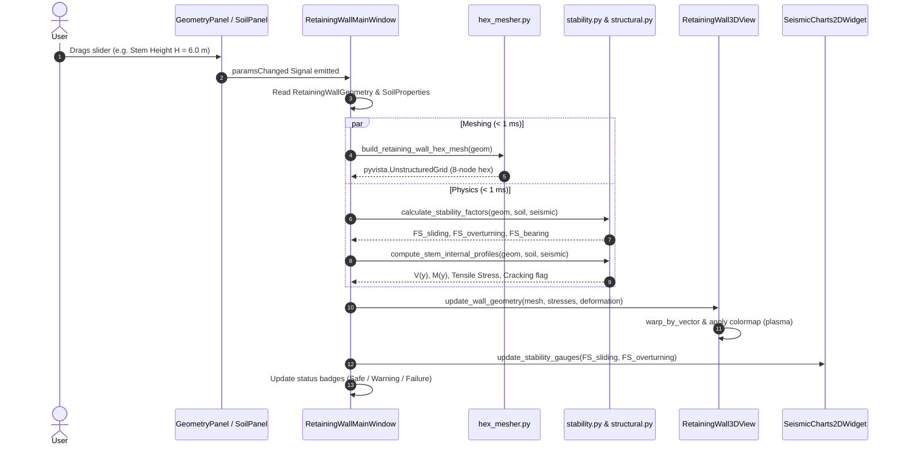

# orang3D System Architecture

This document provides a comprehensive technical overview of the **orang3D** software architecture, component relationships, data pipelines, and design paradigms.

---

## 1. High-Level Design Principles

`orang3D` is engineered around four core tenets:
1. **Interactive Fluidity (The 60 FPS Rule):** Geotechnical engineers must be able to drag geometric and soil sliders smoothly without UI lag or frame dropping. All continuous physics, meshing, and rendering in the main interaction loop execute in **$< 2\text{ ms}$**.
2. **Deep Scientific Fidelity:** Beyond instantaneous limit-equilibrium statics, the application integrates deep continuum dynamic Finite Element Analysis (FEA) via `KratosMultiphysics` to analyze coupled pore-water pressures, soil plasticity, and soil-structure interaction.
3. **Strict Permissive Open-Source Licensing:** Zero proprietary or closed-source dependencies. Every component (`PySide6`, `PyVista`, `PyQtGraph`, `NumPy`, `SciPy`, `KratosMultiphysics`, `h5py`) is licensed under permissive MIT, BSD-3, BSD-4, or LGPLv3 licenses.
4. **Test-Driven Rigor (100% Invariant Guarantees):** Every mathematical equation, geometric mesh cell, and UI binding is verified by automated pytest suites enforcing physical conservation laws ($\sum F=0$, $\sum M=0$, energy conservation, non-decreasing plastic slip).

---

## 2. The Two-Speed Physics Architecture

A central innovation of `orang3D` is its dual-speed computational engine:

```
┌─────────────────────────────────────────────────────────────────────────────────────────────────┐
│                                       PySide6 UI Shell                                          │
│                                                                                                 │
│   [Geometry Dock]       [Soil Properties Dock]       [Seismic & Disasters Dock]   [Scrubber Bar]│
└───────────────┬────────────────────────────┬─────────────────────────────┬──────────────────────┘
                │                            │                             │
                ▼                            ▼                             ▼
┌─────────────────────────────────────────────────────────────────────────────────────────────────┐
│                         SPEED 1: FAST ANALYTICAL LOOP (< 2 ms @ 60 FPS)                         │
│                                                                                                 │
│  1. Validation & Units:                                                                         │
│     models/wall_params.py  ────────►  units.py  ────────►  config.py                             │
│                                                                                                 │
│  2. Pure NumPy 3D Mesher:                                                                       │
│     mesher/hex_mesher.py: 8-node Hexahedral UnstructuredGrid (< 2 ms)                           │
│                                                                                                 │
│  3. Analytical Geotechnical & Structural Solvers:                                               │
│     physics/mononobe_okabe.py: Mononobe-Okabe (Kae, Kah, Kav) + Seed & Whitman                  │
│     physics/stability.py: Sliding FS, Overturning FS, Meyerhof/Hansen Bearing Capacity          │
│     physics/structural.py: Continuous V(y), M(y), Tensile Cracking, ACI 318 Whitney Rebar      │
│     signals/synthetic.py: Limit-equilibrium yield acceleration ky                                │
│                                                                                                 │
│  4. Synchronous UI Update:                                                                      │
│     gui/viewport_3d.py: Update PyVista Mesh, Warp by Deformation, Map Stress Scalar Heatmap    │
│     gui/charts_2d.py: Update PyQtGraph instantaneous safety gauges & baseline curves             │
└────────────────────────────────────────────────┬────────────────────────────────────────────────┘
                                                 │
                                                 │ Trigger Dynamic Analysis / Earthquake Ingestion
                                                 ▼
┌─────────────────────────────────────────────────────────────────────────────────────────────────┐
│                       SPEED 2: DEEP CONTINUUM FEA & DYNAMICS (Background QThread)               │
│                                                                                                 │
│  1. Signal Processing:                                                                          │
│     signals/at2_parser.py: Read PEER NGA .AT2 record, baseline detrending, Butterworth bandpass │
│     signals/synthetic.py: Generate Ricker pulse / harmonic sweep, Arias Intensity Ia, CAV       │
│     signals/synthetic.py: Double-integrate Newmark sliding block downhill displacement u(t)    │
│                                                                                                 │
│  2. Kratos Multiphysics Geomechanics Continuum Solver:                                          │
│     physics/kratos_solver.py (KratosSimulationWorker in QThread):                               │
│     • 2D Plane-Strain coupled u-p hydromechanical formulation (KratosGeoMechanicsApplication)   │
│     • SubModelParts: WallPart, BackfillPart, FoundationPart, InterfacePart, LysmerBoundaryPart   │
│     • OpenMP multi-threaded parallel dynamic time integration                                   │
│     • Lysmer-Kuhlemeyer viscous absorbing boundaries (prevent boundary wave reflections)        │
│     • Pore pressure dissipation & non-linear liquefaction degradation                           │
│     • Real-time progress emission via stepCompleted Qt signal                                   │
│     • Archiving multi-step tensor outputs to HDF5 binary via h5py                               │
└─────────────────────────────────────────────────────────────────────────────────────────────────┘
```

---

## 3. Subsystem Breakdown

### 3.1 Presentation Layer (`src/orang3d/gui/`)
- **[`main_window.py`](file:///home/avisheks/Documents/dibs/orang3d/src/orang3d/gui/main_window.py):** Main application window hosting dock widgets, menu bars, toolbars, status indicators, and coordinating signal/slot connections.
- **[`viewport_3d.py`](file:///home/avisheks/Documents/dibs/orang3d/src/orang3d/gui/viewport_3d.py):** Scientific 3D viewport powered by `pyvistaqt.QtInteractor`. Handles VTK actor lifecycle, camera framing, scalar colormap rendering (`plasma`, `viridis`, `coolwarm`), dynamic vector deformation warping (`warp_by_vector`), and failure wedge rendering.
- **[`charts_2d.py`](file:///home/avisheks/Documents/dibs/orang3d/src/orang3d/gui/charts_2d.py):** Hardware-accelerated 2D plotting via `PyQtGraph`. Visualizes earthquake accelerograms $a(t)$, Newmark cumulative permanent displacement $u(t)$, Arias Intensity curves, and stem shear/moment profiles.
- **[`panels/`](file:///home/avisheks/Documents/dibs/orang3d/src/orang3d/gui/panels/):** Independent dockable input panels:
  - [`geometry_panel.py`](file:///home/avisheks/Documents/dibs/orang3d/src/orang3d/gui/panels/geometry_panel.py): Wall templates (`INVERTED_T`, `L_SHAPED`, `REVERSE_L`, `GRAVITY`), stem dimensions, footing toe/heel lengths, and shear key parameters.
  - [`soil_panel.py`](file:///home/avisheks/Documents/dibs/orang3d/src/orang3d/gui/panels/soil_panel.py): Friction angle ($\phi$), cohesion ($c$), unit weights ($\gamma, \gamma_{\text{sat}}$), foundation properties, and allowable bearing capacity.
  - [`seismic_panel.py`](file:///home/avisheks/Documents/dibs/orang3d/src/orang3d/gui/panels/seismic_panel.py): Horizontal PGA ($k_h$), vertical PGA ($k_v$), water table depth ($H_w$), liquefaction factor ($r_u$), and timeline playhead controls.

### 3.2 Parametric Meshing Engine (`src/orang3d/mesher/`)
- **[`hex_mesher.py`](file:///home/avisheks/Documents/dibs/orang3d/src/orang3d/mesher/hex_mesher.py):** Pure NumPy mesh generator.
  - Does **not** require external binary meshers (like Gmsh or TetGen).
  - Generates 8-node hexahedral brick elements (`VTK_HEXAHEDRON`, cell type 12) with guaranteed positive Jacobian determinants ($\det(J) > 0$).
  - Supports structural multi-templates, rectangular/trapezoidal shear keys, backfill soil prisms, foundation beds, and Coulomb active failure wedges.
  - Computes closed-form volume, surface area, center of gravity ($x_{cg}, y_{cg}, z_{cg}$), and mass moments of inertia ($I_{xx}, I_{yy}, I_{zz}$).
  - Executes in $< 2\text{ ms}$, enabling real-time slider morphing.

### 3.3 Physics & Geotechnical Analysis Engines (`src/orang3d/physics/`)
- **[`mononobe_okabe.py`](file:///home/avisheks/Documents/dibs/orang3d/src/orang3d/physics/mononobe_okabe.py):**
  - Evaluates Mononobe-Okabe (M-O) dynamic earth pressure coefficients ($K_{ae}, K_{pe}$) with seismic inertia angle $\theta = \arctan(k_h / (1 \mp k_v))$.
  - Implements Rankine and Coulomb static limits.
  - Implements Seed & Whitman (1970) resultant partitioning: static component $P_a$ acting at $H/3$, and dynamic increment $\Delta P_{ae}$ acting at $0.6H$.
- **[`stability.py`](file:///home/avisheks/Documents/dibs/orang3d/src/orang3d/physics/stability.py):**
  - Evaluates global limit-equilibrium stability factors:
    - Factor of Safety against Sliding ($FS_s$) considering base friction, adhesion, and passive shear key resistance.
    - Factor of Safety against Overturning ($FS_o$) around the toe edge.
    - Subgrade contact bearing capacity via Meyerhof, Hansen, and Vesic methods with load inclination and eccentricity ($e = B/2 - x_R$) corrections.
  - Coupled disaster modeling: buoyant unit weight $\gamma' = \gamma_{\text{sat}} - \gamma_w$ below water table and non-linear liquefaction shear degradation as $r_u \to 1.0$.
- **[`structural.py`](file:///home/avisheks/Documents/dibs/orang3d/src/orang3d/physics/structural.py):**
  - Continuous shear force $V(y)$ and bending moment $M(y)$ profiles integrated along stem height.
  - Boundary condition enforcement: $M(H) = 0$, $V(H) = 0$; maximum at base junction $y=0$.
  - Flexural tensile stress $\sigma_t(y) = M(y)/Z(y)$ across linearly tapered cross-sections.
  - Concrete cracking prediction against modulus of rupture $f_r = 0.62\sqrt{f'_c}$.
  - ACI 318 / Eurocode 2 flexural reinforcement design using the Whitney rectangular stress block, minimum steel check ($A_{s,\min} = \max(\frac{0.25\sqrt{f'_c}}{f_y}, \frac{1.4}{f_y}) b d$, $\rho_{\text{temp}} = 0.0018$), concrete shear capacity ($\phi V_c$), and engineering rebar callouts (e.g., `T20 @ 150 mm c/c`).
- **[`kratos_solver.py`](file:///home/avisheks/Documents/dibs/orang3d/src/orang3d/physics/kratos_solver.py):**
  - High-fidelity geomechanics continuum solver using `KratosMultiphysics` and `KratosGeoMechanicsApplication`.
  - Discretizes 2D plane-strain continuum into submodel parts: `WallPart`, `BackfillPart`, `FoundationPart`, `InterfacePart` (Coulomb frictional slip), and `LysmerBoundaryPart`.
  - Computes Lysmer-Kuhlemeyer viscous absorbing boundary coefficients ($C_p = \rho V_p$, $C_s = \rho V_s$) to prevent artificial boundary reflection.
  - Coupled hydromechanical $u-p$ dynamic time stepping with pore-water pressure and Cauchy stress tensor $[\sigma_{xx}, \sigma_{yy}, \tau_{xy}]$.
  - [`KratosSimulationWorker`](file:///home/avisheks/Documents/dibs/orang3d/src/orang3d/physics/kratos_solver.py#L297) background `QThread` with cooperative cancellation and HDF5 binary archiving.

### 3.4 Signals & Dynamic Waveforms (`src/orang3d/signals/`)
- **[`synthetic.py`](file:///home/avisheks/Documents/dibs/orang3d/src/orang3d/signals/synthetic.py):**
  - Ricker pulse synthesis with guaranteed zero long-term DC velocity offset.
  - Linear and logarithmic harmonic chirps (1–8 Hz) with smooth cosine-squared (Tukey) window tapering.
  - Energy & intensity metrics: Arias Intensity $I_a(t) = \frac{\pi}{2g}\int [a(\tau) \cdot g]^2 d\tau$ and Cumulative Absolute Velocity $\text{CAV}(t) = \int |a(\tau) \cdot g| d\tau$.
  - Limit-equilibrium yield acceleration $k_y$ considering total system inertia ($W_{\text{total}}$), base shear resistance, and active thrust.
  - Newmark (1965) double-integration sliding block model for permanent cumulative downhill slip $u(t)$.
- **[`at2_parser.py`](file:///home/avisheks/Documents/dibs/orang3d/src/orang3d/signals/at2_parser.py):**
  - Ingestion of PEER NGA / COSMOS / PESMOS strong-motion records with CRLF/LF line-endings and multi-column scientific notation.
  - Polynomial detrending baseline correction.
  - Zero-phase forward-backward Butterworth bandpass filtering (`scipy.signal.butter` + `filtfilt`).

---

## 4. Reactive Data Pipeline

The following sequence diagram illustrates what happens when a user moves a slider in the GUI:



---

## 5. Threading & Concurrency Model

```
Main Thread (PySide6 Event Loop)
┌────────────────────────────────────────────────────────┐
│  • User Event Dispatch (60 FPS)                        │
│  • Fast Analytical Loop (< 2 ms)                       │
│  • OpenGL / VTK Rendering                              │
└───────────────┬──────────────────────────▲─────────────┘
                │                          │
        worker.start()              Qt Signals:
                │                   • stepCompleted(step, t, u, p)
                │                   • simulationFinished(summary)
                │                   • simulationError(error_msg)
                ▼                          │
Background QThread (KratosSimulationWorker)│
┌──────────────────────────────────────────┴─────────────┐
│  • OpenMP multi-threaded parallel FEA                  │
│  • Coupled u-p hydromechanical time stepping           │
│  • Cooperative check: if self._is_cancelled: break     │
│  • Export multi-step results to HDF5 binary            │
└────────────────────────────────────────────────────────┘
```

1. **GUI Responsiveness:** The main Qt thread is never blocked by numerical FEA solvers. All long-running simulations execute inside [KratosSimulationWorker](file:///home/avisheks/Documents/dibs/orang3d/src/orang3d/physics/kratos_solver.py#L297).
2. **Cooperative Cancellation:** Calling `worker.cancel()` sets an atomic boolean `self._is_cancelled = True`. The worker loop polls this flag at every time step, breaks cleanly, frees Kratos resources, and emits `simulationFinished` with partial results.
3. **Headless Execution:** The entire UI and 3D rendering pipeline can execute in headless continuous integration (CI) environments via `QT_QPA_PLATFORM=offscreen`.
