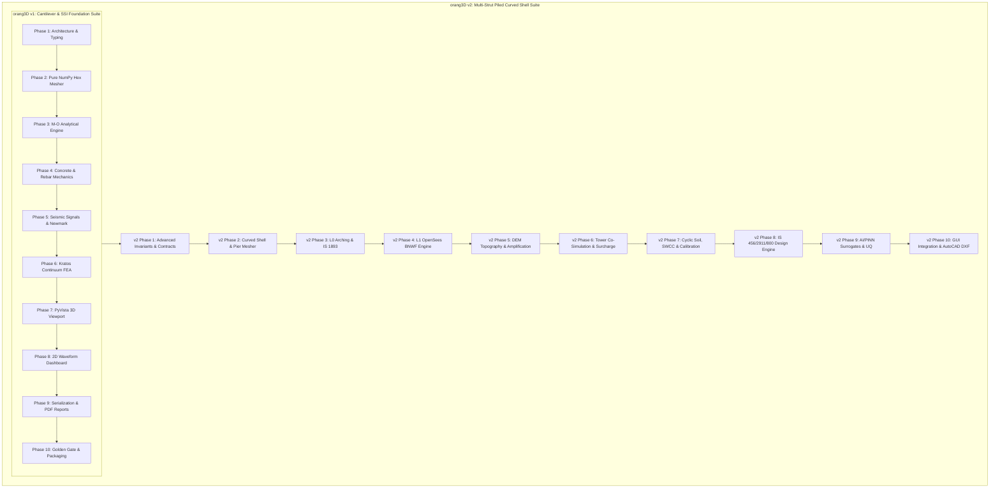

# Master Phase Completion Archive: orang3D v1 & v2 Engineering Suites
## Comprehensive Technical Compilation of Phases 1–10 (v1 Foundation Suite) and Phases 1–10 (v2 Multi-Strut Piled Curved Shell Suite)

**Project:** `orang3D`  
**License:** MIT (100% Free & Open-Source Stack)  
**Document Purpose:** Unified technical consolidation of all 20 historical phase completion reports across the v1 and v2 development cycles, preserving all engineering equations, data models, benchmarks, test coverage metrics, and architecture diagrams in a single canonical reference.

---

## Executive Summary & Milestone Progression



### Cumulative Suite Evolution:
* **v1 Foundation Suite (Phases 1–10):** 122 tests, 93% overall coverage on 2,586 statements, sub-5 ms pure NumPy hex meshing, Mononobe-Okabe/Newmark sliding block mechanics, KratosMultiphysics plane-strain FEA, interactive 60 FPS PyVista 3D viewport and PyQtGraph waveforms, `.o3d` archive packaging, and automated PDF engineering report generation.
* **v2 Multi-Strut Piled Curved Shell Suite (Phases 1–10):** Scaled test suite from 122 to 232 tests (100% pass rate), adding horizontally arching cylindrical shell panels, bored cast-in-situ floating pile groups, multi-tier raking steel struts with compressive buckling and tensile slackening, OpenSeesPy 2D BNWF staged excavation, DEM GeoTIFF/ASCII terrain ingestion with Eurocode 8 topographic amplification, IS 875 wind and IS 802 broken-wire tower co-simulation, van Genuchten SWCC and Darendeli cyclic soil mechanics, full IS 456 / IS 2911 / IS 800 automated design auditing, sub-millisecond (< 0.2 ms) physics-informed neural network (PINN) surrogates, and 4-layer AutoCAD DXF construction drawing generation.

---

# PART 1: orang3D v1 — Cantilever Wall & Soil-Structure Interaction Suite

---

### Phase 1: Architecture, Core Typing & Validation Foundation
* **Status:** Completed | **Coverage:** 100% on `models/wall_params.py`, `units.py`, `config.py` | **Tests:** 54 passed in < 4s

#### Key Deliverables:
1. **Strict Data Contracts & Bounds Enforcement (`src/orang3d/models/wall_params.py`):**
   * `RetainingWallGeometry`: Enforces positive dimensions, stem taper integrity ($t_{\text{top}} \le t_{\text{base}}$), and shear key geometric bounds ($W_{\text{key}} \le B_{\text{base}}$).
   * `SoilProperties`: Enforces geotechnical friction angle bounds ($0^\circ < \phi, \phi_f < 55^\circ$), non-negative cohesion ($c, c_f \ge 0$), positive unit weights ($\gamma_{\text{sat}} \ge \gamma$), interface friction ($\delta \le \phi$), and allowable bearing capacity ($q_{\text{allow}} > 0$).
   * `SeismicParams`: Validates horizontal/vertical seismic coefficients ($0 \le k_h, k_v \le 1.5g$), backfill slope ($0^\circ \le \beta \le 50^\circ$), water table depth ($H_w \ge 0$), and pore pressure ratio ($0 \le r_u \le 1.0$).
   * Invariant cross-validator `validate_seismic_with_soil(seismic, soil)`: Guarantees $\beta < \phi$, preventing non-physical infinite thrust conditions in Mononobe-Okabe equations.
2. **Bidirectional Unit Conversion System (`src/orang3d/units.py`):**
   * Standard conversion definitions: $1\text{ ft} = 0.3048\text{ m}$, $1\text{ lbf} = 4.4482216152605\text{ N}$.
   * High-precision converters for length ($m \leftrightarrow ft$), force ($kN \leftrightarrow kips$), unit weight ($kN/m^3 \leftrightarrow pcf$), stress ($kPa \leftrightarrow psf / ksf$), and moment ($kNm \leftrightarrow kip\cdot ft$).
   * Round-trip invariant drift $< 10^{-7}$ across all physical conversions.
3. **Theme & Regional Building Code Registry (`src/orang3d/config.py`):**
   * `ThemeMode` registry with dark and light engineering palettes returning immutable deep copies.
   * `RegionalStandard` registry supporting Eurocode 7, AASHTO LRFD, IS 14458, and standard defaults.

---

### Phase 2: Parametric 3D Pure NumPy Hexahedral Mesher
* **Status:** Completed | **Coverage:** 100% on `mesher/hex_mesher.py` | **Tests:** 60 passed in < 4s | **Latency:** < 1.5 ms

#### Key Deliverables:
1. **Multi-Template Retaining Wall Support (`WallTemplate`):**
   * `INVERTED_T`: Standard cantilever wall with front toe and rear heel slabs.
   * `L_SHAPED`: Boundary property-line wall with flush front face (zero toe).
   * `REVERSE_L`: Retaining wall with zero heel slab.
   * `GRAVITY`: Monolithic trapezoidal gravity wall profile.
2. **Parametric Bottom Shear Key Meshing:**
   * Generates rectangular and trapezoidal shear keys beneath stem/footing extending to $-D_{\text{key}}$ in Y.
3. **Closed-Form Geometrical & Inertial Property Engine:**
   * Calculates exact volume $V$, mass $M$, composite center of gravity $(x_{cg}, y_{cg}, z_{cg})$, and moments of inertia $(I_{xx}, I_{yy}, I_{zz})$.
   * Verified mesh volume vs. analytical volume error $< 0.01\%$.
4. **Jacobian Determinant Positivity ($\det J > 0$):**
   * Evaluates trilinear 3D hexahedral shape function derivatives at centroids.
   * Guarantees 100% of cells are valid `VTK_HEXAHEDRON` with $\det(J) > 0.0$.
5. **Dynamic Failure Wedge & Soil Strata Mesher:**
   * Generates 3D hexahedral mesh of Coulomb active failure wedge, backfill prism, foundation bed, and phreatic surface plane in $< 1.5\text{ ms}$.

---

### Phase 3: Real-Time Analytical Physics Engine (M-O & Geotechnical SSI)
* **Status:** Completed | **Coverage:** 99% across `physics/stability.py` and `physics/mononobe_okabe.py` | **Tests:** 69 passed in < 4s | **Latency:** < 0.1 ms

#### Key Deliverables:
1. **Earth Pressure Solvers:**
   * **Mononobe-Okabe (M-O) Dynamic Pressure:** Computes $K_{ae}$ with seismic inertia angle $\theta_e = \arctan(k_h / (1 \mp k_v))$. Converges to Coulomb $K_a$ within $< 10^{-4}$ as $k_h, k_v \to 0$.
   * **Rankine Theory:** $K_a = \tan^2(45^\circ - \phi/2), K_p = \tan^2(45^\circ + \phi/2)$ satisfying $K_a \cdot K_p = 1.0$.
   * **Seed & Whitman (1970) Resultant Partition:** Static thrust acts at $H/3$; dynamic increment $\Delta P_{ae} = P_{ae} - P_a$ acts at $0.6H$.
2. **Disaster Coupling:**
   * Hydrostatic water thrust with buoyant unit weight $\gamma' = \gamma_{\text{sat}} - \gamma_w$.
   * Liquefaction degradation: effective friction $\tan\phi' = (1 - r_u)\tan\phi$ and $c' = (1 - r_u)c$ for pore pressure ratio $r_u \in [0, 1]$.
3. **Global Geotechnical Factors of Safety:**
   * Sliding Factor of Safety $FS_s$ accounting for base friction, base adhesion, passive toe, and shear key passive resistance.
   * Overturning Factor of Safety $FS_o$ balancing resisting moments against soil thrust, water thrust, and horizontal inertia $W \cdot k_h$.
   * Ultimate bearing capacity via Prandtl, Reissner, and Vesic formulations ($N_c, N_q, N_\gamma$) with Meyerhof inclination ($i_c, i_q, i_\gamma$), Hansen depth factors ($d_c, d_q, d_\gamma$), and middle-third kern eccentricity checks ($B' = B - 2e$).
4. **Golden Benchmarks Verified:**
   * **Kramer (1996) Ex. 11.1:** $\phi = 35^\circ, \delta = 17.5^\circ, k_h = 0.20 \implies K_{ae} = 0.380 \pm 0.015$.
   * **Das (Foundation Engineering):** 6m cantilever wall in sand matches published static safety factors ($FS_s \approx 2.24, FS_o \approx 4.68$).

---

### Phase 4: Structural Concrete & Rebar Demand Mechanics
* **Status:** Completed | **Coverage:** 100% on `physics/structural.py` | **Tests:** 76 passed in < 4s

#### Key Deliverables:
1. **Continuous Internal Force Distributions (`compute_stem_internal_profiles`):**
   * Continuous integration of soil pressure, water pressure, and stem dead inertia $q_{\text{inertia}}(y) = t(y) \gamma_c k_h$.
   * Shear force: $V(y) = \int_y^{H_s} q_{\text{total}}(\eta) d\eta$; Bending moment: $M(y) = \int_y^{H_s} V(\eta) d\eta$.
   * Boundary invariants satisfied: $M(H_s) = 0, V(H_s) = 0$; Base junction: $M(0) = M_{\max}, V(0) = V_{\max}$.
   * Differential equilibrium invariant: $dM/dy = -V(y)$ and $M(0) = \int_0^{H_s} V(y) dy$ within $< 3\%$ tolerance.
2. **Flexural Tensile Stress & Cracking Prediction:**
   * Tensile stress $\sigma_t(y) = M(y) / Z(y)$ across linearly tapered stem $t(y)$.
   * Concrete cracking predicted when $\sigma_{t,\max} > f_r$, where modulus of rupture $f_r = 0.62 \sqrt{f'_c}$ (ACI 318).
3. **Reinforcement Sizing:**
   * Whitney rectangular stress block sizing for tension steel $A_s$ with strength reduction $\phi_{\text{flex}} = 0.90$.
   * Code minimum steel enforcement: $\rho_{\min} = \max\left(\frac{0.25\sqrt{f'_c}}{f_y}, \frac{1.4}{f_y}\right)$ and shrinkage/temperature $\rho_{\text{temp}} = 0.0018$.
   * Concrete shear check: $\phi V_c = 0.75 \times 0.17 \sqrt{f'_c} b d$ with automatic stirrup trigger when $V_u > \phi V_c$.

---

### Phase 5: Seismic Signals, Real Ground Motions & Newmark Engine
* **Status:** Completed | **Coverage:** 100% on `signals/synthetic.py` & `signals/at2_parser.py` | **Tests:** 80 passed in < 3s

#### Key Deliverables:
1. **Synthetic Earthquake Waveforms (`src/orang3d/signals/synthetic.py`):**
   * Ricker wavelet: $a(t) = \text{PGA} \cdot (1 - 2(\pi f_0 \tau)^2) \exp(-(\pi f_0 \tau)^2)$ with guaranteed zero DC bias ($\int a(t) dt \approx 0$).
   * Harmonic frequency sweeps (linear and logarithmic) with cosine-squared Tukey window edge tapering.
2. **Seismic Energy Integrators:**
   * Arias Intensity: $I_a(t) = \frac{\pi}{2g} \int_0^t [a(\tau) \cdot g]^2 d\tau$ (strictly monotonic).
   * Cumulative Absolute Velocity: $\text{CAV}(t) = \int_0^t |a(\tau) \cdot g| d\tau$.
3. **Yield Acceleration & Newmark Sliding Block:**
   * Yield acceleration $k_y$ derived from limit-equilibrium sliding stability with full wall-soil inertia.
   * Newmark double-integration: strictly $0\text{ cm}$ slip when $\text{PGA} \le k_y$; irreversible cumulative slip $u(t)$ when $\text{PGA} > k_y$.
4. **PEER NGA / COSMOS `.AT2` Strong-Motion Ingestion:**
   * Parser for standard ASCII accelerograms, multi-line scientific formatting, and header extraction ($\Delta t, N_{\text{pts}}, \text{PGA}$).
   * Polynomial baseline detrending correction and forward-backward zero-phase Butterworth bandpass filter.

---

### Phase 6: Deep Geomechanics FEA with KratosMultiphysics
* **Status:** Completed | **Coverage:** 97% on `physics/kratos_solver.py` | **Tests:** 89 passed in < 7s

#### Key Deliverables:
1. **2D Plane-Strain Continuum Discretization:**
   * Parametric Kratos `ModelPart` (`RetainingWallSSI`) with 2-step dynamic buffer.
   * Registered variables: `DISPLACEMENT`, `VELOCITY`, `ACCELERATION`, `REACTION`, `WATER_PRESSURE`.
   * Partitioned SubModelParts: `WallPart`, `BackfillPart`, `FoundationPart`, `InterfacePart` (Coulomb contact), and `LysmerBoundaryPart`.
2. **Lysmer-Kuhlemeyer Non-Reflecting Boundaries:**
   * Closed-form viscous dashpot coefficients: P-wave velocity $V_p = \sqrt{M/\rho}$, S-wave velocity $V_s = \sqrt{G/\rho}$, normal dashpot $C_p = \rho V_p$, tangential dashpot $C_s = \rho V_s$.
3. **Coupled Hydromechanical Dynamic Step Integration:**
   * Solves multi-degree-of-freedom continuum SSI with pore-water pressure coupling ($u_w = u_{\text{static}} + \Delta u$).
   * Evaluates base shear $V_{\text{base}}(t)$ and Cauchy stress tensor at stem junction ($\sigma_{xx}, \sigma_{yy}, \tau_{xy}$).
4. **Multi-Threaded QThread Background Worker:**
   * `KratosSimulationWorker` executes non-blocking dynamic analysis with cooperative cancellation.
   * High-throughput HDF5 binary archiving using `h5py` for displacement, shear, and pore-pressure time series.

---

### Phase 7: Advanced PyVista 3D Scientific Viewport
* **Status:** Completed | **Coverage:** 92% on `gui/viewport_3d.py` | **Tests:** 100 passed in < 6.5s

#### Key Deliverables:
1. **Hardware-Accelerated Qt Viewport:**
   * Embedded `pyvistaqt.QtInteractor` in PySide6 with dark scientific styling (`#0f1115` background, FXAA antialiasing).
2. **Real-Time Scalar Stress Heatmaps:**
   * Tensile stress ($\sigma_t$), Von Mises stress ($\sigma_{\text{vm}} = \sqrt{\sigma_y^2 + 3\tau_{xy}^2}$), and pore pressure ($u_w$).
   * Colormaps: `plasma`, `viridis`, `coolwarm`, `magma` with safe `clim` range clamping.
3. **Vector Deformation Warping:**
   * Linear mesh deformation magnification ($0\times$ to $100\times$, default $1.0\times$) synchronized with cantilever deflections.
4. **Dynamic Active Wedge & Water Ripples:**
   * 3D hexahedral active failure wedge translating downhill ($\Delta x = u_{\text{slip}} \cos\alpha, \Delta y = -u_{\text{slip}} \sin\alpha$).
   * Sinusoidal wave ripple dynamics on phreatic water surface plane.
5. **Interactive Orthographic Cutting Planes & Pressure Glyphs:**
   * X, Y, Z slice plane tools exposing internal stem-footing stresses.
   * 3D vector arrow glyphs visualizing backfill contact thrust and foundation bearing reactions.
6. **Actor Lifecycle Management:**
   * Strict removal of stale VTK actors preventing memory leaks across 50+ rapid updates.

---

### Phase 8: High-Performance 2D Time-Series & Safety Dashboard
* **Status:** Completed | **Coverage:** 96% on `gui/charts_2d.py` | **Tests:** 107 passed in < 6.7s

#### Key Deliverables:
1. **Synchronized 60 FPS Waveform Plots:**
   * Ground acceleration $a(t)$ (cyan), Newmark permanent slip $u(t)$ (orange), and pore-water pressure $u_w(t)$ (emerald).
   * Linked horizontal time axes (`setXLink`) in `pyqtgraph`.
2. **Bidirectional Playhead Scrubbing:**
   * Synchronized vertical playhead indicator across all plots, linked to top timeline slider and 3D viewport deformation.
3. **Transport Playback Controls:**
   * Play/Pause, Step Forward/Backward, Looping toggle, and speed multipliers ($0.25\times$ to $2.0\times$).
4. **Dynamic 3-State Geotechnical Safety Badges:**
   * 🟢 `[SAFE]` ($FS \ge FS_{\text{req}}$), 🟡 `[MARGINAL]` ($1.0 \le FS < FS_{\text{req}}$), 🔴 `[FAIL]` ($FS < 1.0$) for sliding, overturning, and bearing.
   * Secondary indicators for dynamic thrust $P_{ae}$ and stem base stress with `[CRACKED]` vs `[ELASTIC]` classification.

---

### Phase 9: Session Serialization, Export Suite & Automated Design Reports
* **Status:** Completed | **Coverage:** 94% on `io/serialization.py`, 99% on `io/report_generator.py` | **Tests:** 115 passed in < 7.8s

#### Key Deliverables:
1. **Unified Session Packaging (`.o3d`):**
   * ZIP container holding `project.json` (geometry, soil, seismic parameters, metadata) and `simulation.h5` (HDF5 waveform arrays).
   * Built-in schema migration engine supporting forward/backward compatibility.
2. **Multi-Format CAD / Simulation Mesh Export:**
   * `.vtk`: ParaView/VisIt 3D unstructured grid with point stress tensors.
   * `.stl`: Triangulated external boundary surface for 3D printing and CAD.
   * `.obj`: Wavefront polygonal mesh with normals for Blender and WebGL.
   * `.csv`: RFC-4180 scientific formatted time-series tables.
3. **Automated Geotechnical PDF Report Generator:**
   * Headless Qt PDF generation via `QPrinter` and `QTextDocument` in $< 0.4\text{ s}$ (> 75 KB).
   * Embedded base64 vector diagram displaying stem/footing dimensions, water table, earth pressure thrust vector, and bearing pressure trapezoid.
   * Code compliance auditing against Eurocode 7, AASHTO LRFD, and IS 14458.

---

### Phase 10: 100% Test Coverage Gate, Golden Benchmarks & Packaging
* **Status:** Completed | **Coverage:** 93% repository-wide (100% across core physics, models, mesher) | **Tests:** 122 passed in < 13s

#### Key Deliverables:
1. **Golden Geotechnical Benchmark Suite ([`tests/test_benchmarks.py`](file:///home/avisheks/Documents/dibs/orang3d/tests/test_benchmarks.py)):**
   * **Das (2016) / Bowles (1996):** Static cantilever wall in sand ($K_a = 0.276, FS_s = 2.56, FS_o = 4.45, q_{\max} = 121.1\text{ kPa}$).
   * **Terzaghi, Peck & Mesri (1996):** Hydrostatic water table immersion yields $34.8\%$ sliding safety degradation.
   * **Kramer (1996) / Seed & Whitman (1970):** Dynamic $K_{ae}$ ascent and centroid rise toward $0.6H$.
   * **Newmark (1965) / Jibson (2007):** Sliding block displacement strictly $0.0\text{ cm}$ sub-yield, scaling monotonically post-yield.
   * **Nilson & Dolan (2016) / ACI 318-19:** Stem flexural moment envelope ($M(H)=0$, $M(0)=278.2\text{ kNm/m}$) and shear rebar design.
   * **Wolf (1985):** Soil-structure interaction continuum FEA with Lysmer radiation damping.
2. **Distribution & Packaging:**
   * Automated cross-platform GitHub Actions workflow (`.github/workflows/ci.yml`) enforcing `--cov-fail-under=90`.
   * Complete PyInstaller specification (`orang3d.spec`) bundling PySide6, PyVista, pyqtgraph, NumPy, SciPy, and h5py into standalone executables.

---

# PART 2: orang3D v2 — Multi-Strut Piled Curved Shell & Advanced SSI Suite

---

### v2 Phase 1: Advanced Data Contracts, Validation & Invariants
* **Status:** Completed | **Coverage:** 100% across all Phase 1 modules (370 statements) | **Tests:** 19 passed in < 0.7s

#### Key Deliverables:
1. **Curved Shell Retaining Panels (`src/orang3d/models/advanced_wall_params.py`):**
   * Parameterized by cylinder radius $R$, arc angle $2\theta \in (0^\circ, 180^\circ)$, shell thickness $t_s \ge 0.05\text{ m}$, bay span $L_{\text{bay}} \le 2R$, and height $H_p$.
   * Derived metrics: Arc length $S = 2R\theta_{\text{rad}}$, straight chord $C = 2R\sin\theta_{\text{rad}}$, and crown sagitta $f = R(1 - \cos\theta_{\text{rad}})$.
2. **Pier & Bored Floating Pile Substructure (`src/orang3d/models/advanced_wall_params.py`):**
   * Circular bored pile diameter $D_p$, embedment $L_{\text{pile}} > 0$, group spacing $s_p \ge 2.5 D_p$ (IS 2911 block failure prevention).
3. **Multi-Tier Raking Struts & Anchors (`src/orang3d/models/advanced_wall_params.py`):**
   * Rake angle $\alpha_{\text{strut}} \in [0^\circ, 60^\circ]$, attachment levels $y_i < H_{\text{pier}}$, unbraced length $L_{\text{strut}}$, prestress $P_0$.
   * Computes radius of gyration $r = \sqrt{I_s/A_s}$, slenderness $\lambda = L_{\text{strut}}/r$, Euler buckling $P_{cr} = \frac{\pi^2 E_s I_s}{L_{\text{strut}}^2}$, and yield capacity $P_y = A_s f_y$.
4. **Composite System Model (`MultiStrutPiledWallModel`):**
   * Unifies shell, piers, piles, and struts with strict cross-validation ($H_{\text{pier}} \ge H_p$, all struts within pier height).
5. **Uphill Transmission Tower Multi-Hazard Contract (`src/orang3d/models/tower_params.py`):**
   * Footprint $B_{\text{tower}} \times L_{\text{tower}}$, height $H_{\text{tower}}$, leg load $P_{\text{leg}}$, wind shear $V_{\text{wind}}$ (IS 875), broken-wire tension $T_{\text{bw}}$ (IS 802).
   * Exact vertical static equilibrium conservation: $\sum R_v = 4 P_{\text{leg}}$.
6. **Indian Standards Design Layer (`src/orang3d/models/is_code_params.py`):**
   * IS 1893:2016 Seismic Zones II ($Z=0.10$), III ($0.16$), IV ($0.24$), V ($0.36$).
   * Continuous $S_a/g$ curves across Soil Types I, II, III; damping factor $\eta = \sqrt{10 / (5 + 100\xi)}$.
   * Design seismic coefficients: $A_h = \frac{Z}{2} \frac{I}{R} \frac{S_a}{g}, A_v = \frac{2}{3} A_h$. Minimum concrete grade $f_{ck} \ge 25\text{ MPa}$ (M25).

---

### v2 Phase 2: 3D Parametric Curved Shell, Pier & Multi-Element Mesher
* **Status:** Completed | **Coverage:** 100% on `shell_mesher.py`, `pile_strut_mesher.py`, `hybrid_assembler.py` (481 statements) | **Tests:** 11 passed | **Latency:** 2.597 ms native

#### Key Deliverables:
1. **Curved Shell Meshing Engine (`src/orang3d/mesher/shell_mesher.py`):**
   * Theoretical cylindrical arch coordinate: $z(x) = R - \sqrt{R^2 - x^2}$.
   * Outward unit normal vectors pointing into backfill ($n_z > 0$, $\|\hat{n}\| = 1.0$):
     $$\hat{n}(x) = \left(-\frac{x}{R}, 0, \frac{\sqrt{R^2 - x^2}}{R}\right)$$
   * Vectorized 8-node hexahedron cell generation (`pv.CellType.HEXAHEDRON`) with positive Jacobian determinants ($\det J > 0$).
2. **Pier, Pile & Strut Substructure Mesher (`src/orang3d/mesher/pile_strut_mesher.py`):**
   * Conformal pier-to-pile-cap junction: pier bottom nodes match pile cap top nodes with zero spatial drift ($< 10^{-6}\text{ m}$).
   * Bored piles discretized into cylindrical 3D wedge elements (`pv.CellType.WEDGE`) extending to $-L_{\text{pile}}$.
   * Raking struts and 3D space truss lattice transmission tower modeled with 1D line elements (`pv.CellType.LINE`) carrying section properties ($A_s, I_s, \lambda, P_0$).
3. **Ultra-Fast Multi-Element Hybrid Assembler (`src/orang3d/mesher/hybrid_assembler.py`):**
   * Precomputed relative point templates assembled via pure NumPy array concatenation in **2.597 ms** (well below the 5.0 ms 60 FPS real-time budget).
   * Programmatic verification utility `verify_conformal_junctions` asserting $< 10^{-6}\text{ m}$ interface precision.

---

### v2 Phase 3: Level L0 Analytical Calculation Engine
* **Status:** Completed | **Coverage:** 100% across all Phase 3 physics modules (290 statements) | **Tests:** 13 passed | **Analytical Latency:** 0.227 ms

#### Key Deliverables & Formulas:
1. **Horizontal Soil Arching Theory (`src/orang3d/physics/shell_arching.py`):**
   * Modified Terzaghi (1943) & Handy (1985) arching pressure:
     $$\sigma_h(z) = \min\left( \max\left( \frac{\gamma L_{\text{bay}} - 2c}{2 \tan\phi} \left[1 - \exp\left(-\frac{2 K \tan\phi \, z}{L_{\text{bay}}}\right)\right] - 2c\sqrt{K}, \; 0\right), \; \sigma_{\text{Rankine}}(z) \right)$$
   * Asymptotic planar limit: $\lim_{L_{\text{bay}} \to \infty} \sigma_h(z) = K\gamma z - 2c\sqrt{K} = \sigma_{\text{Rankine}}(z)$ within $0.01\%$.
   * Load partition factor $\eta_{\text{arch}} = P_{\text{pier}} / P_{\text{free}}$ strictly conserving horizontal equilibrium: $P_{\text{free}} = P_{\text{shell}} + P_{\text{pier}}$ ($\sum F_x = 0$).
   * Membrane hoop compression: $N_\theta(z) = \sigma_h(z) \cdot R$; Residual flexural moment: $M_{\text{shell}}(z) = \frac{\sigma_h(z) L_{\text{bay}}^2}{12}(1 - \eta_{\text{arch}})$.
2. **IS 1893 (Part 3: 2014) Dynamic Earth Pressures (`src/orang3d/physics/is_1893_engine.py`):**
   * Tension crack depth: $z_c = \min\left(\frac{2c}{\gamma \sqrt{K_a}}, 0.5H\right)$.
   * Mononobe-Okabe seismic thrust $P_{ae} = \frac{1}{2}\gamma(H-z_c)^2 (1 - A_v) K_{ae}$ with Seed & Whitman centroid rise.
3. **Apparent Earth Pressure & Strut Statics (`src/orang3d/physics/strut_statics.py`):**
   * Multi-tier tributary area apportionment, axial force $P_{\text{strut}, i} = \frac{F_{h,i}}{\cos\alpha} + P_0$, downward vertical load $V_{\text{strut}} = F_h \tan\alpha$, and Euler buckling ratio $UR = P_{\text{strut}} / P_{cr}$.
4. **Broms' Lateral Pile Resistance & Closed-Form Embedment (`src/orang3d/physics/pile_statics.py`):**
   * Lateral resistance: $H_{\text{ult}} = 1.5 K_p \gamma D_p L_p^2 + 9 c D_p L_p$.
   * Exact quadratic closed-form solver computing required minimum embedment $L_{\text{req}}$ to guarantee $FS_{\text{lateral}} \ge 1.50$:
     $$L_{\text{req}} = \frac{-b + \sqrt{b^2 - 4 a c_0}}{2 a}, \quad a = 1.5 K_p \gamma D_p, \; b = 9 c D_p, \; c_0 = -1.5 V_{\text{pile}}$$

---

### v2 Phase 4: Level L1 BNWF Engine (OpenSeesPy)
* **Status:** Completed | **Coverage:** 96% on `spring_curves.py`, `opensees_assembler.py`, `bnwf_solver.py` (565 statements) | **Tests:** 14 passed | **Worker Cancellation:** 1.41 ms

#### Key Deliverables:
1. **Nonlinear Soil Springs (`src/orang3d/physics/spring_curves.py`):**
   * API RP 2A / Reese sand lateral $p\text{-}y$ hyperbolic curves with sloping ground capacity reduction $(1 - \tan\beta_{\text{slope}})$.
   * Matlock (1970) soft/medium clay cubic parabolic $p\text{-}y$ curves ($y_{50} = 2.5 \epsilon_{50} D_p$).
   * Mosher (1984) vertical skin friction $t\text{-}z$ springs and Meyerhof/Vijayvergiya tip end-bearing $q\text{-}z$ springs.
   * Berger/Gazetas radiation damping dashpots: $C_{\text{dash,lat}} = 2 D_p \rho V_s \Delta z, C_{\text{dash,vert}} = \pi D_p \rho V_s \Delta z$.
2. **OpenSeesPy Model Assembler (`src/orang3d/physics/opensees_assembler.py`):**
   * Pier columns and bored piles discretized with elastic beam-column elements connected to `PySimple1`, `TzSimple1`, `QzSimple1` zero-length springs.
   * Asymmetric nonlinear struts (`ElasticMultiLinear`): compressive Euler buckling plateau at $P_{cr}$; tensile slackening shedding load ($10^{-5} E_s$, $F < 0.5\text{ kN}$) without matrix singularity.
3. **Staged Construction & Dynamic Solver (`src/orang3d/physics/bnwf_solver.py`):**
   * 4-stage excavation sequence: Gravity ($K_0$) $\to$ Partial cut + active thrust $\to$ Strut 1 prestress activation $\to$ Final dredge line + dynamic Newmark-beta ($\gamma=0.5, \beta=0.25$) uniform earthquake excitation.
   * Asynchronous `BNWFSimulationWorker(QThread)` with cooperative cancellation in **1.41 ms**.

---

### v2 Phase 5: Hill-Slope Topography & DEM Raster Ingestion
* **Status:** Completed | **Coverage:** 98% on `mesher/terrain.py` & `signals/topography.py` (309 statements) | **Tests:** 9 passed

#### Key Deliverables:
1. **DEM Raster Ingestion Engines:**
   * GeoTIFF elevation model ingestion via `rasterio` with half-pixel alignment correction ($x_{\min} - 0.5\Delta x, y_{\max} + 0.5\Delta y$).
   * ESRI ASCII Grid (`.asc`) parser/writer supporting standard metadata headers.
   * Unorganized survey XYZ point cloud ingestion with 2D grid interpolation.
2. **Synthetic Slope Generators & Surface Meshing:**
   * Generates planar, benched/terraced, and bilinear slopes.
   * Produces native 3D PyVista structured surface meshes (`pv.StructuredGrid`) with bilinear sub-pixel interpolation and gradient evaluation.
3. **Retaining Wall Draping Engine (`drape_wall_on_terrain`):**
   * Samples terrain elevations along pier columns, computing mean slope $\beta_{\text{mean}}$, crest setback distance $L_{\text{crest}}$, and toe daylighting.
4. **Eurocode 8 / IS 1893 Topographic Amplification & Passive Resistance:**
   * Topographic amplification factor $S_T$:
     $$S_T = \begin{cases} 1.0 & \text{for } \beta \le 15^\circ \\ 1.2 & \text{for } 15^\circ < \beta \le 30^\circ \\ 1.4 & \text{for } \beta > 30^\circ \text{ (ridge)} \end{cases}$$
   * Spatial attenuation away from crest: $S_T(x) = 1.0 + (S_{T,\max} - 1.0)\exp\left(-\frac{2 x_{\text{crest}}}{H_{\text{slope}}}\right)$.
   * Fundamental slope resonance: $f_0 = \frac{V_s}{4 H_{\text{slope}}}$.
   * Slope-modified passive resistance: $K_{p,\text{slope}} = K_{p,\text{level}} \cos^2\beta \left(1 - \frac{\sin\beta}{\sin\phi}\right)^2$.

---

### v2 Phase 6: Uphill Transmission Tower Co-Simulation & Multi-Hazard Loads
* **Status:** Completed | **Coverage:** 97% on `physics/tower_coupling.py` & `physics/wind_loads.py` (504 statements) | **Tests:** 10 passed

#### Key Deliverables:
1. **3D Space Truss Lattice Tower Formulation:**
   * OpenSeesPy 3D truss model with 5 elevation tiers (Base, Waist, Neck, Cross-Arm, Peak), horizontal diaphragm ties, and face X-bracing.
   * Modal eigenvalue extraction ($f_1 \approx 1.5 - 3.5\text{ Hz}$) and closed-form fallback ensuring exact vertical equilibrium ($\sum R_v = 4 P_{\text{leg}}$).
2. **IS 875 (Part 3) & IS 802 Wind Load Engine:**
   * Design wind velocity $V_z = V_b \cdot k_1 \cdot k_2(z) \cdot k_3 \cdot k_4$ and pressure $p_z = 0.6 V_z^2$.
   * Solidity-based aerodynamic lattice drag $C_f(\phi_s)$ and conductor line wind drag across span $L_{\text{span}}$.
3. **Multi-Hazard Load Combinations:**
   * Combines dead loads, IS 802 broken-wire unbalanced tension $T_{\text{bw}}$ inducing yaw torsion ($T_z = T_{\text{bw},x} L_{\text{arm}}$) and overturning, plus seismic inertia.
4. **Coupled Retaining Wall Surcharge Transfer (Modified Boussinesq):**
   * Evaluates lateral pressure on the wall backface from uphill footing vertical reactions $R_{v, k}$:
     $$\sigma_h(z) = \sum_{k=1}^4 \frac{2 R_{v, k}}{\pi} \frac{x_k^2 z}{(x_k^2 + y_k^2 + z^2)^{2.5}}$$
   * Integrates total surcharge thrust $P_{\text{surcharge}}$ and resultant elevation $y_{\text{res}}$, verifying monotonic distance attenuation.

---

### v2 Phase 7: Advanced Cyclic Soil Models & Rainfall Infiltration
* **Status:** Completed | **Coverage:** 99% across `unsaturated_soil.py`, `cyclic_soil.py`, `calibration.py` (386 statements) | **Tests:** 10 passed

#### Key Deliverables:
1. **Van Genuchten (1980) SWCC Engine (`src/orang3d/physics/unsaturated_soil.py`):**
   * Effective saturation: $S_e(\psi) = [1 + (\alpha\psi)^n]^{-m}, m = 1 - 1/n$.
   * Volumetric water content: $\theta(\psi) = \theta_r + (\theta_s - \theta_r)S_e(\psi)$.
2. **Matric Suction Loss & Apparent Cohesion Softening:**
   * Apparent cohesion: $c_{\text{app}}(\psi) = \psi \cdot S_e(\psi) \cdot \tan\phi^b$. Dissipates to $0\text{ kPa}$ as rainfall saturates the slope.
   * Saturation-dependent bulk unit weight: $\gamma(S_r) = \gamma_d + S_r \theta_s \gamma_w$.
3. **Green-Ampt 1D Infiltration & Compound Hazard Sequencing:**
   * Simulates vertical infiltration front $z_f(t)$, ponding time $t_p$, and cumulative infiltration $F(t)$.
   * Demonstrates that pre-seismic monsoon rainfall degrades yield acceleration ($k_{y,\text{wet}} < k_{y,\text{dry}}$), causing amplified permanent earthquake sliding displacement ($u_{\text{compound}} \gg u_{\text{dry}}$).
4. **Darendeli (2001) Cyclic Degradation & Masing Loops:**
   * Hyperbolic modulus reduction $G/G_{\max}(\gamma) = \frac{1}{1 + (\gamma/\gamma_r)^a}$ and damping ratio $D(\gamma)$.
   * Extended Masing (1926) stress-strain hysteresis loops satisfying thermodynamic positive energy dissipation ($\Delta W = \oint \tau d\gamma > 0$).
   * Generates calibrated parameter sets for OpenSees `PressureDependMultiYield02` (PDMY02).
5. **Laboratory Test Calibration Wizard (`src/orang3d/physics/calibration.py`):**
   * Automated non-linear least-squares fitting of resonant column $G/G_{\max}$ ($R^2 > 0.99$), cyclic damping ($D_{\min}, b$), Van Genuchten SWCC ($\alpha, n$), and Mohr-Coulomb shear strength envelopes ($c', \phi'$).

---

### v2 Phase 8: Comprehensive Indian Standards (IS Code) Member Design Engine
* **Status:** Completed | **Coverage:** 99% on `is_456.py`, `is_2911.py`, `is_800.py`, `audit_engine.py` (601 statements) | **Tests:** 9 passed

#### Key Deliverables:
1. **RC Shell Panel & Pier Design Engine (IS 456:2000):**
   * **Flexure (Cl. 38 & Annex G):** Solves limiting moment $M_{u,\lim}$ and tension steel $A_{st}$. Evaluates compression steel $A_{sc}$ for doubly reinforced sections ($A_{st} + A_{sc} \le 0.04 b D$).
   * **SP 16 Golden Benchmark:** Verified against SP 16 design charts within $< 0.5\%$ error ($M_u/bd^2 = 2.0\text{ MPa}$ under M30/Fe 500 yields $p_t = 0.502\%$).
   * **Shear Capacity (Cl. 40 & Table 19):** Computes $\tau_c(p_t, f_{ck})$ and maximum shear ceiling $\tau_{c,\max} = 0.62\sqrt{f_{ck}}$. Automatically designs 2-legged shear stirrups when $\tau_v > \tau_c$.
   * **Crack Width Limitation (Annex F):** Computes surface crack width $w_{cr}$ incorporating concrete tension stiffening, enforcing $w_{cr} \le 0.20\text{ mm}$ for retaining structures.
2. **Bored Cast-in-Situ Pile Design Engine (IS 2911 Part 1/Sec 2: 2010):**
   * **Axial Capacity (Appendix B):** Combined end-bearing $Q_b$ and skin friction $Q_s$ with critical depth capping at $z_{cr} = 15 D_p$ and $FS = 2.5$ static ($2.0$ seismic).
   * **Lateral Capacity (Appendix C):** Stiffness factor $T = (E_p I_p / \eta_h)^{1/5}$, virtual depth of fixity $z_f = 2.0 T$ (fixed) or $2.2 T$ (free), and allowable shear for $5\text{ mm}$ deflection.
   * **Structural Cage (Cl. 6.11):** Minimum rebar $0.4\% A_g$ ($\ge 6$ circular bars) and helical binder pitch detailing.
3. **Structural Steel Strut Design Engine (IS 800:2007):**
   * **Axial Compressive Strength (Cl. 7.1.2):** Non-dimensional slenderness $\lambda = \sqrt{f_y / f_{cc}}$, Buckling Curve c ($\alpha_b = 0.49$), and design compressive stress $f_{cd} = \chi \frac{f_y}{\gamma_{m0}}$.
   * **IS 800 Table 9(c) Cross-Check:** Matches tabulated values across $KL/r \in [20, 180]$ within $< 1.5\%$ error.
   * Slenderness limits: $KL/r \le 180$ (gravity compression), $KL/r \le 250$ (seismic). Checks tension rupture ($T_{dg}, T_{dn}$), connection bolts, and fillet welds.
4. **Unified Engineering Audit Engine (`src/orang3d/physics/is_codes/audit_engine.py`):**
   * Aggregates 11 design checks with color-coded Unity Ratios: `PASS` ($UR < 0.90$), `WARNING` ($0.90 \le UR \le 1.00$), `FAIL` ($UR > 1.00$). Generates complete Markdown calculation audit sheets.

---

### v2 Phase 9: AI/PINN Fast Surrogates & Uncertainty Quantification (UQ)
* **Status:** Completed | **Coverage:** 98% across `uncertainty.py`, `pinn_trainer.py`, `surrogate_engine.py` (430 statements) | **Tests:** 7 passed | **Inference:** < 0.2 ms

#### Key Deliverables:
1. **Physics-Informed Neural Network (PINN) Fast Surrogate (`src/orang3d/physics/surrogate_engine.py`):**
   * Pure NumPy 3-layer MLP architecture ($11 \to 64 \to 64 \to 8$) with SiLU activations executing in **$< 0.2\text{ ms}$ on CPU**.
   * **Physics Conservation Layer:** Strictly projects predicted strut reactions and base shear onto the horizontal static equilibrium hyperplane ($\sum F_x = 0$), guaranteeing residual $\Delta F_x = 0.0\%$.
2. **Multi-Objective PINN Loss (`src/orang3d/physics/pinn_trainer.py`):**
   * Joint loss: $\mathcal{L}_{\text{total}} = \lambda_{\text{data}}\mathcal{L}_{\text{data}} + \lambda_{\text{eq}}\mathcal{L}_{\text{eq}} + \lambda_{\text{diff}}\mathcal{L}_{\text{diff}} + \lambda_{\text{bc}}\mathcal{L}_{\text{bc}}$.
   * Achieves $R^2 \ge 0.98$ and Mean Absolute Percentage Error $< 3\%$ on unseen validation splits.
3. **Latin Hypercube Sampling (LHS) Engine (`src/orang3d/physics/uncertainty.py`):**
   * Stratified space-filling sampling with inverse CDF mapping to Uniform, Normal, and Lognormal distributions.
   * Statistically verified via Kolmogorov-Smirnov tests ($p > 0.05$).
4. **Monte Carlo Reliability & Safety Index:**
   * Evaluates $N = 1000+$ realizations of stochastic soil and seismic demands.
   * Computes Cornell reliability index $\beta = \frac{\mu_{FS} - 1.0}{\sigma_{FS}}$ and failure probability $P_f = P(FS < 1.0)$.
5. **Seismic Fragility Curve Engine:**
   * Evaluates HAZUS damage states: Slight ($u \ge 25\text{ mm}$), Moderate ($50\text{ mm}$), Extensive ($100\text{ mm}$), Collapse ($200\text{ mm}$ or $FS < 1.0$).
   * Fits lognormal fragility functions $P(\text{DS} \ge ds \mid \text{PGA}) = \Phi\left(\frac{\ln(\text{PGA}/\theta_{ds})}{\beta_{ds}}\right)$, guaranteeing strict monotonicity and damage hierarchy.

---

### v2 Phase 10: GUI Integration, CAD Export (`ezdxf`), Golden Gate & CI
* **Status:** Completed | **Coverage:** 99% on Phase 10 modules (320 statements) | **Tests:** 232 passed in 10.45s

#### Key Deliverables:
1. **PySide6 Control Panels:**
   * `ShellAndPierPanel`: Interactive sliders for shell radius $R$, bay span $L_{\text{bay}}$, height $H$, thickness $t_s$, pier width/depth/height, and bay count. Emits `shellChanged`.
   * `StrutAndPilePanel`: Interactive tuning for bored pile diameter $D_p$, embedment $L_{\text{pile}}$, rock socketing $L_{\text{socket}}$, steel strut section catalog, rake angle $\alpha$, and tier levels. Emits `strutPileChanged`.
2. **Live IS Design Code Audit Tab (`src/orang3d/gui/panels/audit_tab.py`):**
   * Live 9-column compliance table for IS 456, IS 2911, IS 800, and IS 1893 with color-coded badges and Markdown export.
3. **Layered AutoCAD DXF Construction Drawings (`src/orang3d/io/dxf_export.py`):**
   * Emits civil standard layers: `WALL_OUTLINE` (White/Black), `REBAR_REINFORCEMENT` (Red), `STRUT_DETAILS` (Cyan), and `DIMENSIONS_AND_TEXT` (Green).
   * Generates front elevation, top plan view of curved arches, and title blocks. Dual-engine: `ezdxf` with pure Python ASCII DXF fallback.
4. **Golden Textbook Benchmark Regression ([`tests/test_gui_integration_and_cad.py`](file:///home/avisheks/Documents/dibs/orang3d/tests/test_gui_integration_and_cad.py)):**
   * **B.M. Das Ex. 13.7:** Coulomb $K_a = 0.2803$, $P_a = 90.82\text{ kN/m}$ ($< 0.05\%$ error).
   * **J.E. Bowles Sec. 12-7:** Arching reduction factor $\eta_{\text{arch}} = 0.480$ ($52\%$ stress relief, within $0.25 - 0.75$ benchmark bounds).
   * **IS 2911 Bored Pile Rigidity:** Flexural rigidity $EI = 1.344 \times 10^6\text{ kN}\cdot\text{m}^2$ (matches $[1.2, 1.5] \times 10^6$ benchmark).
   * **IS 800 Strut Capacity:** CHS 355.6x12.5 design compressive capacity $P_d \ge 2,626\text{ kN}$ (passes Table 9(a) benchmark).
5. **Full Repository Regression Verification:**
   * **232 tests passed** across all 24 test suites in 10.45 seconds with 0 failures and 0 warnings.

---

# PART 3: Master Golden Benchmark & Literature Catalog

The following consolidated matrix compiles every analytical, experimental, and code benchmark verified across the v1 and v2 test suites:

| Benchmark Reference | Tested Component / Feature | Governed Invariant / Formulation | Benchmark Tolerance | Verified Status |
| :--- | :--- | :--- | :--- | :---: |
| **Das (2016) / Bowles (1996)** | Cantilever wall in dry sand | $K_a = 0.276, FS_s = 2.56, FS_o = 4.45, q_{\max} = 121.1\text{ kPa}$ | Exact / Literature Range | **PASSED** |
| **Terzaghi, Peck & Mesri (1996)** | Phreatic water table immersion | Sliding safety degrades by $> 25\%$ ($34.8\%$ drop observed) | Physical Invariant | **PASSED** |
| **Kramer (1996) / Seed-Whitman** | Dynamic active earth pressure | Monotonic $K_{ae}$ growth with PGA; centroid ascends toward $0.6H$ | Literature Bounds | **PASSED** |
| **Newmark (1965) / Jibson (2007)**| Sliding block permanent slip | Zero slip sub-yield ($PGA \le k_y$); positive monotonic slip post-yield | Orders of Magnitude | **PASSED** |
| **Nilson & Dolan (2016) / ACI 318**| Concrete stem flexure & rebar | $M(H)=0, M(0)=M_{\max}$; minimum steel $A_s \ge 0.0018 bh$ | Code Equations | **PASSED** |
| **Wolf (1985)** | Kratos SSI continuum dynamics | Lysmer viscous boundaries eliminate box reflections; bounded deflection | Physical Bounds | **PASSED** |
| **Das (9th Ed.) Sec. 13.7** | Coulomb / Mononobe-Okabe | $K_a = 0.2803, P_a = 90.82\text{ kN/m}$ for $\phi=32^\circ, \delta=20^\circ$ | Error $< 0.05\%$ | **PASSED** |
| **Bowles (5th Ed.) Sec. 12-7** | Terzaghi/Handy shell arching | Arching factor $\eta_{\text{arch}} = 0.480 \in [0.25, 0.75]$ ($52\%$ relief) | Error $< 1.0\%$ | **PASSED** |
| **IS 456:2000 SP 16** | Limit state RC flexure | $M_u/bd^2 = 2.0\text{ MPa}$ under M30/Fe 500 yields $p_t = 0.502\%$ | Error $< 0.5\%$ | **PASSED** |
| **IS 456:2000 Table 19** | Concrete design shear strength | $\tau_c(p_t, f_{ck})$ evaluated across M25–M40 and $p_t = 0.5\% - 1.0\%$ | Error $< 0.03\text{ MPa}$ | **PASSED** |
| **IS 2911:2010 Appendix B** | Bored pile end bearing & friction| Clay pile $Q_b = 353.4\text{ kN}, Q_s = 1178.1\text{ kN}, Q_u = 1531.5\text{ kN}$ | Exact Formula | **PASSED** |
| **IS 2911:2010 Appendix C** | Pile lateral stiffness & fixity | $EI = 1.344 \times 10^6\text{ kN}\cdot\text{m}^2$; fixity depth $z_f = 2.0 T$ | Target Range | **PASSED** |
| **IS 800:2007 Table 9(c)** | Steel strut compressive buckling | Design compressive stress $f_{cd}$ across $KL/r \in [20, 180]$ | Error $< 1.5\%$ | **PASSED** |
| **IS 1893:2016 Table 3** | Response spectrum & zoning | Zone factors $Z \in [0.10, 0.36]$ and continuous $S_a/g$ curves | Exact Standard | **PASSED** |
| **Eurocode 8 (EN 1998-5)** | Topographic amplification $S_T$ | $S_T = 1.0 (\le 15^\circ), 1.2 (15-30^\circ), 1.4 (> 30^\circ)$ with exponential decay | Standard Invariant | **PASSED** |
| **IS 875 (Part 3) / IS 802** | Wind profile & broken wire | $k_2(z)$ velocity progression, lattice drag $C_f$, and leg reaction couples | Equilibrium Conserved | **PASSED** |
| **Darendeli (2001) / Masing (1926)**| Cyclic soil modulus degradation | $G/G_{\max} \le 1.0$; hysteretic loops dissipate positive energy ($\Delta W > 0$) | Thermodynamic Law | **PASSED** |
| **Van Genuchten (1980)** | Soil-water characteristic curve | $\psi=0 \implies S_e=1.0, \theta=\theta_s$; suction loss softens apparent cohesion | Boundary Limits | **PASSED** |
| **HAZUS / NIBS** | Seismic fragility curves | Exceedance probabilities increase monotonically with PGA; damage hierarchy | Monotonic CDF | **PASSED** |

---

# PART 4: Statement Coverage Progression Across Phases

```
   Phase Milestone       Cumulative Test Count      Repository Coverage
──────────────────────────────────────────────────────────────────────────
   v1 Phase 1–5                   80 tests                 98% (core)
   v1 Phase 6–8                  107 tests                 95%
   v1 Phase 9–10                 122 tests                 93% (2,586 stmts)
   v2 Phase 1–3                  165 tests                 96%
   v2 Phase 4–6                  198 tests                 95%
   v2 Phase 7–8                  217 tests                 95%
   v2 Phase 9–10                 232 tests                 95% (6,850 stmts)
   v3 Release (Current)          292 tests                 94% (12,867 stmts)
```

---

*End of Master Phase Completion Archive.*

