# orang3D v3: Research-Grade Seismic Retaining Wall & 3D SSI Development Plan
## 10-Phase Implementation Blueprint for Students, Researchers, and Architects (100% Free & Open-Source Stack)

**Target Version:** `0.2.0` -> `1.0.0`  
**Baseline Commit:** `f64ba43` (`main`)  
**Audience:** Geotechnical/Structural Students, Academic Researchers, and Practicing Architects  
**License Policy:** 100% Free & Open-Source (`MIT`, `BSD-2/3/4`, `LGPLv3`, `PSF`) — zero proprietary licenses or paid cloud APIs.

---

## 1. Executive Summary & Current Baseline Audit

### 1.1 Baseline Capabilities Already in `orang3d`
As of commit `f64ba43`, both the v1 (cantilever retaining wall) and v2 (multi-strut piled curved shell) 10-phase plans are implemented in `src/orang3d/` (~15,610 LOC across source modules, ~7,996 LOC across 23 test files):
- **Wired into Desktop GUI (`src/orang3d/gui/main_window.py`):**
  - Fast (`< 1 ms`) Mononobe-Okabe + Seed–Whitman dynamic active thrust, Meyerhof/Hansen/Vesic bearing capacity, and limit-equilibrium sliding/overturning ([mononobe_okabe.py](file:///home/avisheks/Documents/dibs/orang3d/src/orang3d/physics/mononobe_okabe.py), [stability.py](file:///home/avisheks/Documents/dibs/orang3d/src/orang3d/physics/stability.py)).
  - Continuous cantilever stem $V(y), M(y)$ and ACI 318 rebar sizing ([structural.py](file:///home/avisheks/Documents/dibs/orang3d/src/orang3d/physics/structural.py)).
  - PEER `.AT2` strong-motion parser, Ricker/harmonic synthesizers, and Newmark downhill sliding integration ([at2_parser.py](file:///home/avisheks/Documents/dibs/orang3d/src/orang3d/signals/at2_parser.py), [synthetic.py](file:///home/avisheks/Documents/dibs/orang3d/src/orang3d/signals/synthetic.py)).
  - PyVista 3D viewport rendering extruded cantilever hex meshes, failure wedges, water ripples, and pressure glyphs ([viewport_3d.py](file:///home/avisheks/Documents/dibs/orang3d/src/orang3d/gui/viewport_3d.py), [hex_mesher.py](file:///home/avisheks/Documents/dibs/orang3d/src/orang3d/mesher/hex_mesher.py)).
  - Live IS 456 / IS 2911 / IS 800 / IS 1893 compliance audit tab ([audit_tab.py](file:///home/avisheks/Documents/dibs/orang3d/src/orang3d/gui/panels/audit_tab.py)), layered AutoCAD `.dxf` export ([dxf_export.py](file:///home/avisheks/Documents/dibs/orang3d/src/orang3d/io/dxf_export.py)), `.o3d` serialization ([serialization.py](file:///home/avisheks/Documents/dibs/orang3d/src/orang3d/io/serialization.py)), and PDF calculation reports ([report_generator.py](file:///home/avisheks/Documents/dibs/orang3d/src/orang3d/io/report_generator.py)).
- **Implemented & Tested in Backend Only (Not Yet Wired into `src/orang3d/gui/`):**
  - Parametric 3D curved shell, pier, pile, and strut mesh assembly ([shell_mesher.py](file:///home/avisheks/Documents/dibs/orang3d/src/orang3d/mesher/shell_mesher.py), [pile_strut_mesher.py](file:///home/avisheks/Documents/dibs/orang3d/src/orang3d/mesher/pile_strut_mesher.py), [hybrid_assembler.py](file:///home/avisheks/Documents/dibs/orang3d/src/orang3d/mesher/hybrid_assembler.py)).
  - OpenSeesPy 2D BNWF nonlinear soil-spring solver ([opensees_assembler.py](file:///home/avisheks/Documents/dibs/orang3d/src/orang3d/physics/opensees_assembler.py), [bnwf_solver.py](file:///home/avisheks/Documents/dibs/orang3d/src/orang3d/physics/bnwf_solver.py)).
  - DEM terrain ingestion and EC8/IS 1893 topographic amplification ([terrain.py](file:///home/avisheks/Documents/dibs/orang3d/src/orang3d/mesher/terrain.py), [topography.py](file:///home/avisheks/Documents/dibs/orang3d/src/orang3d/signals/topography.py)).
  - Cyclic/unsaturated soil mechanics, lab calibration, PINN fast surrogate, Monte Carlo UQ & fragility, and tower coupling ([cyclic_soil.py](file:///home/avisheks/Documents/dibs/orang3d/src/orang3d/physics/cyclic_soil.py), [unsaturated_soil.py](file:///home/avisheks/Documents/dibs/orang3d/src/orang3d/physics/unsaturated_soil.py), [calibration.py](file:///home/avisheks/Documents/dibs/orang3d/src/orang3d/physics/calibration.py), [surrogate_engine.py](file:///home/avisheks/Documents/dibs/orang3d/src/orang3d/physics/surrogate_engine.py), [uncertainty.py](file:///home/avisheks/Documents/dibs/orang3d/src/orang3d/physics/uncertainty.py), [tower_coupling.py](file:///home/avisheks/Documents/dibs/orang3d/src/orang3d/physics/tower_coupling.py)).

### 1.2 Critical Gaps Blocking "Research-Grade" & Architectural Adoption
1. **Kratos FEA Is Currently an SDOF Analytical Surrogate:** In [`kratos_solver.py`](file:///home/avisheks/Documents/dibs/orang3d/src/orang3d/physics/kratos_solver.py#L47-L267), `initialize_model()` creates corner nodes without finite elements or constitutive laws, and `run_dynamic_step()` evaluates hardcoded closed-form SDOF equations ($f_0 = 3.5\text{ Hz}, f_{\text{drive}} = 2.0\text{ Hz}$).
2. **No True 3D Continuum Earthquake Pressure Solver:** Current earth pressures (`mononobe_okabe.py`, `stability.py`) are 2D unit-width formulas extruded visually in 3D, missing 3D corner effects, curved bay spatial arching under dynamics, and bidirectional ($X+Z+Y$) seismic excitation.
3. **Disconnected v2 GUI & Cross-Platform Gap:** `KratosMultiphysics` is Linux-only, while cross-platform `OpenSeesPy` (2D BNWF and 3D continuum) is not exposed in the GUI. `THEME_LIGHT` ([config.py](file:///home/avisheks/Documents/dibs/orang3d/src/orang3d/config.py#L40-L59)) and `UnitSystem` ([units.py](file:///home/avisheks/Documents/dibs/orang3d/src/orang3d/units.py)) are also unexposed in `gui/`.
4. **Known Baseline Defects:**
   - `_export_mesh_dialog` in [`main_window.py`](file:///home/avisheks/Documents/dibs/orang3d/src/orang3d/gui/main_window.py#L597-L605) passes `(mesh, path)` instead of `(geom, results, filepath)` expected by [`mesh_export.py`](file:///home/avisheks/Documents/dibs/orang3d/src/orang3d/io/mesh_export.py#L17-L78).
   - [`test_engineering_pdf_report_generation`](file:///home/avisheks/Documents/dibs/orang3d/tests/test_io.py#L265-L306) fails its `< 1.5s` latency gate (`2.21s` observed).
   - `ezdxf` and `openseespy` are omitted from [requirements.txt](file:///home/avisheks/Documents/dibs/orang3d/requirements.txt), and `openseespy` is omitted from [pyproject.toml](file:///home/avisheks/Documents/dibs/orang3d/pyproject.toml).

---

## 2. 10-Phase Roadmap Overview

```mermaid
flowchart LR
    P1["Phase 1: Hygiene, Bugs & Solver Registry"] --> P2["Phase 2: Wire v2 3D Mesher & OpenSees 2D BNWF"]
    P2 --> P3["Phase 3: True 2D/3D Continuum Seismic FEA"]
    P3 --> P4["Phase 4: Soil Calibration, Cyclic/Unsat & UQ UI"]
    P4 --> P5["Phase 5: Student Pedagogy & Model Comparison"]
    P5 --> P6["Phase 6: Multi-Code Audits (EC7/EC8, AASHTO, ACI) & Units"]
    P6 --> P7["Phase 7: Architectural Wall Morphologies & Surcharges"]
    P7 --> P8["Phase 8: Site DEM Topography & Architect Studio Mode"]
    P8 --> P9["Phase 9: Research Deck Export & 3D CAD/BIM"]
    P9 --> P10["Phase 10: 3D Golden Benchmarks, Cross-Platform CI & Release"]
```

---

## 3. Free & Open-Source Dependency Matrix

| Capability | Library / Package | License | Current Status in `.venv` | Required? |
| :--- | :--- | :--- | :--- | :--- |
| Desktop UI | `PySide6` | LGPLv3 | Installed (`6.12.0`) | Core |
| 3D Viewport & Meshing | `pyvista`, `pyvistaqt` | MIT | Installed (`0.49.2`, `0.13.1`) | Core |
| 2D Plotting | `pyqtgraph`, `matplotlib` | MIT / PSF | Installed (`0.14.0`, `3.11.2`) | Core |
| Numerics & Optimization | `numpy`, `scipy` | BSD-3 | Installed (`2.5.4`, `1.18.1`) | Core |
| Cross-Platform 2D/3D FEA | `openseespy` | BSD-2 | Installed | Core (Pin in `pyproject.toml`) |
| Linux Continuum $u$-$p$ FEA | `KratosMultiphysics` + `GeoMechanics` | BSD-4 | Installed (`10.4.4`, Linux) | Optional/Linux |
| CAD Export (2D/3D DXF) | `ezdxf` | MIT | Installed (`1.4.5`) | Core (Pin in `requirements.txt`) |
| Mesh & HDF5 Data | `meshio`, `h5py` | MIT / BSD-3 | Installed (`5.3.5`, `3.16.0`) | Core |
| GeoTIFF DEM Import | `rasterio` or `tifffile` | BSD / MIT | Optional (not installed) | Optional (`[terrain]` extra) |
| BIM `.ifc` Export | `ifcopenshell` | LGPLv3 | Optional (not installed) | Optional (`[bim]` extra) |
| PyTorch PINN Training | `torch` | BSD-3 | Optional (not installed) | Optional (`[ai]` extra; NumPy fallback works) |

---

## 4. Detailed Phase-by-Phase Implementation Plan

---

### Phase 1: Baseline Hygiene, Bug Fixes & Solver Capability Registry

#### 1.1 Objectives
Stabilize the existing test suite, eliminate known UI/export bugs, synchronize packaging manifests, and create a unified solver capability registry so the UI cleanly routes analytical, 2D BNWF, and 3D FEA runs across Linux and Windows.

#### 1.2 Features & Exact Changes
1. **Fix `_export_mesh_dialog` Signature Mismatch:**
   - Update [`src/orang3d/gui/main_window.py`](file:///home/avisheks/Documents/dibs/orang3d/src/orang3d/gui/main_window.py#L587-L606) so `_export_mesh_dialog` calls `export_mesh_to_vtk(self.geom, self.results, path)` (and similarly for `.stl` and `.obj`), and add an overload/helper in [`src/orang3d/io/mesh_export.py`](file:///home/avisheks/Documents/dibs/orang3d/src/orang3d/io/mesh_export.py) supporting exporting an arbitrary `pyvista.UnstructuredGrid` (needed for exporting curved shell/pile/3D FEA meshes in Phase 2/3).
2. **Optimize PDF Report Generation Latency:**
   - Profile [`src/orang3d/io/report_generator.py`](file:///home/avisheks/Documents/dibs/orang3d/src/orang3d/io/report_generator.py) (avoid redundant Matplotlib figure initialization, lower non-essential DPI from 300 -> 150 or reuse cached `FigureCanvasAgg`) so [`tests/test_io.py::test_engineering_pdf_report_generation`](file:///home/avisheks/Documents/dibs/orang3d/tests/test_io.py#L265-L306) consistently passes `< 1.5s`.
3. **Synchronize Dependency Manifests:**
   - Add `ezdxf>=1.1.0` and `openseespy>=3.5.0` to [requirements.txt](file:///home/avisheks/Documents/dibs/orang3d/requirements.txt).
   - Add `openseespy>=3.5.0` to [pyproject.toml](file:///home/avisheks/Documents/dibs/orang3d/pyproject.toml), plus optional extras `[terrain]` (`rasterio`), `[bim]` (`ifcopenshell`), and `[ai]` (`torch`).
4. **Solver Capability & Provenance Registry (`src/orang3d/physics/solver_registry.py`):**
   - Create `SolverTier` Enum (`L0_ANALYTICAL`, `L0_PINN`, `L1_OPENSEES_2D_BNWF`, `L2_OPENSEES_3D_FEA`, `L2_KRATOS_FEA`).
   - Create `SolverProvenance` dataclass recording solver name, version, element types, damping model, runtime (ms), convergence status, and random seed for every simulation result.

#### 1.3 Acceptance Criteria & Tests
- `tests/test_io.py` passes 100% including `test_engineering_pdf_report_generation` (< 1.5s) and a new `test_main_window_mesh_export_dialog` calling `_export_mesh_dialog` without raising `TypeError`.
- `tests/test_solver_registry.py` verifies platform detection (`OPENSEES_AVAILABLE`, `KRATOS_AVAILABLE`) and graceful fallback messaging.

---

### Phase 2: GUI Integration of Existing v2 3D Meshes, OpenSees 2D BNWF & PINN Surrogate

#### 2.1 Objectives
Expose the already-implemented v2 multi-strut curved shell mesher, OpenSeesPy 2D BNWF solver, and PINN surrogate inside the desktop application so user changes in *Curved Shell* and *Strut & Piles* drive live 3D rendering and real nonlinear SSI calculations.

#### 2.2 Features & Exact Changes
1. **Structural System Mode Selector in `MainWindow` & `Viewport3D`:**
   - Add `WallSystemMode` Enum (`CANTILEVER`, `MULTI_STRUT_CURVED_SHELL`) in [`src/orang3d/models/advanced_wall_params.py`](file:///home/avisheks/Documents/dibs/orang3d/src/orang3d/models/advanced_wall_params.py).
   - Update [`src/orang3d/gui/viewport_3d.py`](file:///home/avisheks/Documents/dibs/orang3d/src/orang3d/gui/viewport_3d.py) with `update_multi_strut_scene(model: MultiStrutPiledWallModel, num_bays: int, soil: SoilProperties, seismic: SeismicParams, arching_res: ShellArchingResult, bnwf_res: Optional[BNWFSimulationResult])`:
     - Calls [`assemble_multi_strut_piled_wall_mesh`](file:///home/avisheks/Documents/dibs/orang3d/src/orang3d/mesher/hybrid_assembler.py#L33) to render curved shell panels, vertical piers, pile caps, bored piles, and raking struts (`ElementType` color/scalar mapping + deformed shape overlay).
     - Adds visibility toggles in `Viewport3D` control bar for *Piles*, *Struts*, and *Shell Arching Stress*.
   - Update [`_on_shell_changed`](file:///home/avisheks/Documents/dibs/orang3d/src/orang3d/gui/main_window.py#L382) and [`_on_strut_pile_changed`](file:///home/avisheks/Documents/dibs/orang3d/src/orang3d/gui/main_window.py#L390) to trigger live 3D shell/pile re-meshing and arching stress computation (`compute_shell_arching_partition`).
2. **OpenSeesPy 2D BNWF Worker & Controls:**
   - Add `BNWFSimulationWorker(QThread)` in [`src/orang3d/physics/bnwf_solver.py`](file:///home/avisheks/Documents/dibs/orang3d/src/orang3d/physics/bnwf_solver.py) (supporting cooperative cancellation, staged excavation, lateral pushover, and dynamic `UniformExcitation`).
   - Add toolbar action **"Run 2D BNWF (OpenSees)"** + mode selector (`Staged + Dynamic` / `Pushover Curve`) in [`main_window.py`](file:///home/avisheks/Documents/dibs/orang3d/src/orang3d/gui/main_window.py).
   - Render BNWF outputs (pile/pier deflection envelope, bending moment $M(y)$, shear $V(y)$, strut axial load history, and pushover $V_{\text{base}}$ vs. $\Delta_{\text{crest}}$) in [`charts_2d.py`](file:///home/avisheks/Documents/dibs/orang3d/src/orang3d/gui/charts_2d.py).
3. **PINN Fast Surrogate Integration:**
   - Wire [`FastPINNSurrogate`](file:///home/avisheks/Documents/dibs/orang3d/src/orang3d/physics/surrogate_engine.py#L100) into `MainWindow` with an optional *"Live PINN Envelope"* overlay in `charts_2d.py` displaying equilibrium imbalance (`%`) and inference latency (`ms`).

#### 2.3 Acceptance Criteria & Tests
- `tests/test_gui_v2_integration.py` verifies switching to `MULTI_STRUT_CURVED_SHELL` renders shell/pier/pile/strut actors in `Viewport3D` offscreen, runs `BNWFSimulationWorker` end-to-end on a synthetic wavelet without UI freeze, and updates `Charts2DWidget`.
- 3D scene update latency remains `< 16 ms` for slider drags in both Cantilever and Multi-Strut modes.

---

### Phase 3: True 2D & 3D Continuum Seismic Earth Pressure FEA (OpenSeesPy 3D + Kratos)

#### 3.1 Objectives
Eliminate the closed-form SDOF placeholder in `kratos_solver.py` and build a true, cross-platform **3D continuum dynamic Soil-Structure Interaction (SSI) engine** capable of capturing 3D earth-pressure distributions, wall-corner effects, soil nonlinearity, pore-water pressure generation, and multi-directional earthquake shaking.

#### 3.2 Features & Exact Changes
1. **True 3D Continuum Mesher for FEA (`src/orang3d/mesher/continuum_fea_mesher.py`):**
   - Generate conformal structured/unstructured 3D brick meshes (`VTK_HEXAHEDRON` / `8-node hexahedra`) with shared/interface node topology across:
     - Retaining wall structure (cantilever stem+footing+key **or** curved shell+piers+piles+struts).
     - Backfill soil block (`extent_back >= 3H`, longitudinal length `L_wall + 2*buffer` for 3D corner/boundary studies).
     - Foundation subgrade (`depth >= 2B`).
     - **Thin-layer / Zero-length Coulomb Friction Interface Elements** between wall backface/base and soil (allowing separation/gapping and sliding rather than glued nodes).
     - **Free-field / Lysmer-Kuhlemeyer Viscous Dashpot Boundaries** on lateral and bottom truncated faces ($C_p = \rho V_p A_{\text{trib}}$, $C_s = \rho V_s A_{\text{trib}}$) to prevent artificial box wave reflections.
2. **Cross-Platform 3D Nonlinear Continuum Solver (`src/orang3d/physics/opensees_3d_solver.py`):**
   - Uses `ops.model("basic", "-ndm", 3, "-ndf", 3)` (soil bricks) + `-ndf 6` (structural shells/beams via `equalDOF` / `ShellMITC4` / `dispBeamColumn` / `stdBrick`).
   - **Constitutive Soil Models (selectable):**
     - `ElasticIsotropic` (linear verification & modal baseline).
     - `PressureDependMultiYield02` / `PressureIndependMultiYield` (nonlinear hysteretic shear-volume coupling, cyclic mobility, and pore-pressure buildup in `u-p` / `BrickUP` elements for liquefaction).
   - **Multi-Directional Seismic Loading:** Apply 1D, 2D ($X+Y$), or 3D ($X+Z+Y$) `UniformExcitation` ground-motion time histories (supporting multi-component `.AT2` sets).
   - **3D Outputs (`ContinuumFEAResult` dataclass):**
     - Time histories of 3D displacement field $u_x, u_y, u_z(x,y,z,t)$.
     - **Wall backface normal & shear earth pressure fields** $\sigma_{nn}(y, z, t)$ and $\tau(y, z, t)$ integrated into total 3D thrust $P_{ae,3D}(t)$, dynamic thrust elevation $h_{\text{res}}(t)$, and corner-to-midspan pressure concentration ratio.
     - Soil octahedral shear strain, excess pore-water pressure ratio $r_u(x,y,z,t)$, and foundation bearing stress map.
   - Cooperative `OpenSees3DFEAWorker(QThread)` with per-step progress signals, live abort/cancel (`cancel_check`), and HDF5 caching.
3. **True Kratos GeoMechanics Continuum Solver (`src/orang3d/physics/kratos_solver.py`):**
   - Replace the SDOF formula in [`run_dynamic_step`](file:///home/avisheks/Documents/dibs/orang3d/src/orang3d/physics/kratos_solver.py#L209-L267) with actual Kratos `ModelPart` element/condition population (`UPwSmallStrainElement2D4N` / `UPwSmallStrainElement3D8N`, `MohrCoulomb` / `LinearElastic` constitutive JSON parameters, `GeoMechanicsAnalysis` or explicit `SolvingStrategy` step loop).
   - Keep a clearly labeled `solver_mode="kratos_fea"` vs. optional fast preview, never mislabeling an analytical SDOF calculation as FEA.
4. **3D FEA Post-Processing in `Viewport3D`:**
   - Render 3D earth-pressure contours directly on the wall backface ($\sigma_{xx}(y, z)$), soil shear-strain / $r_u$ isosurfaces, and animated 3D deformed time-steps from the HDF5 cache.

#### 3.3 Acceptance Criteria & Tests
- `tests/test_continuum_fea_3d.py`:
  - **Patch Test & Geostatic $K_0$ Equilibrium:** Gravity turn-on produces vertical stress $\sigma_{yy} = \gamma z$ (< 1% error) and horizontal stress $\sigma_{xx} = K_0 \gamma z$ with zero spurious lateral drift.
  - **Static Active Transition:** Rigid-wall slight outward translation converges toward Rankine/Coulomb active thrust on smooth vs. rough interfaces.
  - **Lysmer Absorbing Boundary Test:** Outgoing P/S impulse shows < 5% spurious reflection energy at truncated boundaries.
  - **3D Corner / Finite-Length Effect Test:** Short wall bounded by rigid side walls or piers produces lower mid-height pressure than an unrestrained long wall.
  - **Kratos Authenticity Test (Linux):** Verifies `KratosRetainingWallSolver.initialize_model()` populates `Elements` (`> 0`) and `Conditions` (`> 0`), and `run_dynamic_step()` queries real Kratos nodal `DISPLACEMENT` / `WATER_PRESSURE` / element `CAUCHY_STRESS_TENSOR` results.

---

### Phase 4: Soil Mechanics Lab Calibration, Cyclic/Unsaturated Soil & Probabilistic UQ UI

#### 4.1 Objectives
Bring the Phase 7 & Phase 9 research modules (`cyclic_soil.py`, `unsaturated_soil.py`, `calibration.py`, `uncertainty.py`) into the interactive GUI for graduate research and advanced soil characterization.

#### 4.2 Features & Exact Changes
1. **Cyclic & Unsaturated Soil Sub-Panel (`src/orang3d/gui/panels/advanced_soil_panel.py`):**
   - Expose [`CyclicSoilParameters`](file:///home/avisheks/Documents/dibs/orang3d/src/orang3d/physics/cyclic_soil.py) ($G_{\max}$, reference strain $\gamma_r$, curvature $a$, small-strain damping $D_{\min}$, $N$-cycle degradation) and live $G/G_{\max}(\gamma)$ & $D(\gamma)$ PyQtGraph plots.
   - Expose [`VanGenuchtenParams`](file:///home/avisheks/Documents/dibs/orang3d/src/orang3d/physics/unsaturated_soil.py) ($\theta_s, \theta_r, \alpha, n$) + rainfall infiltration duration/intensity, plotting the SWCC and matric suction profile $\psi(z, t)$ and suction-augmented shear strength.
2. **Lab Data Calibration Wizard (`src/orang3d/gui/dialogs/calibration_wizard.py`):**
   - Import CSV laboratory test points for Resonant Column / Cyclic Triaxial, Pressure Plate SWCC, and Direct Shear / Triaxial tests.
   - Call [`calibration.py`](file:///home/avisheks/Documents/dibs/orang3d/src/orang3d/physics/calibration.py) (`fit_cyclic_modulus_reduction_curve`, SWCC fit, Mohr-Coulomb envelope fit), plot measured vs. fitted curves, report $R^2$ and RMSE, and apply calibrated parameters directly to the active project.
3. **Uncertainty Quantification & Seismic Fragility Tab (`src/orang3d/gui/panels/uq_fragility_tab.py`):**
   - Configure random variable distributions (`Normal`, `Lognormal`, `Uniform`) for $\phi, c, \gamma, k_h, R$ via [`DistributionConfig`](file:///home/avisheks/Documents/dibs/orang3d/src/orang3d/physics/uncertainty.py#L29).
   - Run Latin Hypercube Sampling + Monte Carlo simulations (`N = 200` to `10,000`) using `FastPINNSurrogate` or analytical stability in a worker thread.
   - Display FS histogram, Cornell reliability index $\beta$, failure probability $P_f = P(FS < 1.0)$, and monotonic HAZUS-style seismic fragility curves (Slight, Moderate, Extensive, Collapse) vs. PGA.

#### 4.3 Acceptance Criteria & Tests
- `tests/test_advanced_soil_uq_ui.py` verifies CSV lab calibration fit ($R^2 \ge 0.95$ on synthetic benchmark data) pushes updated parameters into `SoilProperties`, and UQ worker produces deterministic seeded $\beta, P_f$, and monotonic fragility curves in offscreen Qt tests.

---

### Phase 5: Student Pedagogy, Math Transparency & Multi-Solver Comparison

#### 5.1 Objectives
Turn `orang3d` into an interactive teaching laboratory where students can see *every equation*, compare classical theories against nonlinear SSI/FEA, run parameter sweeps, and load textbook/experimental benchmarks in one click.

#### 5.2 Features & Exact Changes
1. **"Show the Math" Equation Inspector Tab (`src/orang3d/gui/panels/equation_inspector_tab.py`):**
   - Generates structured, step-by-step HTML/KaTeX-free rich text (native `QTextBrowser` with crisp Unicode math + color-coded substituted numbers) for:
     - Active coefficients ($K_a$ Rankine, $K_a$ Coulomb, $K_{ae}$ Mononobe-Okabe, seismic inertia angle $\theta_e$).
     - Resultant thrust breakdown ($P_a, \Delta P_{ae}, P_w$) and application heights ($H/3$ vs. $0.6H$).
     - Sliding, overturning, eccentricity $e = B/2 - \sum M / \sum V$, and Meyerhof bearing terms ($N_c, N_q, N_\gamma, i_c, i_q, i_\gamma, d_c, d_q$).
     - Shell horizontal arching reduction factor $\eta_{\text{arch}}$ and stem $V_{\max}, M_{\max}, f_r$.
2. **Theory vs. BNWF vs. 3D FEA Comparison Plot (`src/orang3d/gui/panels/comparison_tab.py`):**
   - Side-by-side depth profiles ($z = 0 \to H$) overlaying:
     - Classical Rankine static pressure $\sigma_a(z)$
     - Mononobe-Okabe / Seed–Whitman dynamic pressure $\sigma_{ae}(z)$
     - Curved shell arching pressure $\sigma_h(z)$
     - OpenSees 2D BNWF bending moment $M(y)$ & deflection $\Delta(y)$
     - OpenSees 3D / Kratos Continuum FEA mid-bay & corner pressure $\sigma_{xx}(z)$
   - Computes and displays quantitative discrepancy metrics (peak thrust % diff, max moment % diff, resultant height $h_{\text{res}}/H$).
3. **Parametric Sensitivity Sweep Dialog (`src/orang3d/gui/dialogs/sensitivity_dialog.py`):**
   - Select X-axis variable ($k_h \in [0, 0.5g]$, $\phi \in [20^\circ, 45^\circ]$, water table depth, $r_u$, $L_{\text{bay}}/H$) and Y-axis metrics ($K_{ae}$, $FS_{\text{sliding}}$, $FS_{\text{overturning}}$, $FS_{\text{bearing}}$, $u_{\text{Newmark}}$).
   - Plots live sweep curves with code safety thresholds overlaid as dashed horizontal lines.
4. **Built-In Textbook & Centrifuge Benchmark Presets (`src/orang3d/models/presets.py`):**
   - Curated presets selectable from `File -> Load Benchmark Preset...`:
     - *Das (9th Ed.) Ex. 13.7* Coulomb/M-O cantilever wall
     - *Bowles (5th Ed.) Sec. 12-7* soil arching bay
     - *Kramer (1996)* Seed–Whitman + Newmark sliding wall
     - *IS 14458 / IS 1893 Zone V* hill-slope piled shell retaining wall
     - *3D Corner Effect Benchmark* (short vs. long retaining wall under $0.3g$ shaking)

#### 5.3 Acceptance Criteria & Tests
- `tests/test_pedagogy_and_presets.py` verifies every preset loads cleanly, matches its published analytical target within `< 0.5%`, and sensitivity sweeps generate finite monotonic curves within `< 50 ms`.

---

### Phase 6: Multi-Code International Design Audits & Full SI/Imperial Unit Parity

#### 6.1 Objectives
Broaden academic and global professional adoption by integrating Eurocode 7/8, AASHTO LRFD, and ACI 318 alongside Indian Standards in the live audit dashboard, and wiring SI/Imperial unit switching across the entire UI.

#### 6.2 Features & Exact Changes
1. **Unified Multi-Code Audit Engine (`src/orang3d/physics/code_auditor.py`):**
   - Refactor/extend [`audit_engine.py`](file:///home/avisheks/Documents/dibs/orang3d/src/orang3d/physics/is_codes/audit_engine.py) behind a common `DesignCodeAuditor` interface supporting [`RegionalStandard`](file:///home/avisheks/Documents/dibs/orang3d/src/orang3d/config.py#L76-L82):
     - **Indian Standards:** IS 456:2000, IS 2911, IS 800:2007, IS 1893:2016, IS 14458.
     - **Eurocode 7 & Eurocode 8 (EN 1997-1 / EN 1998-5):** Partial factors (DA1-C1/C2), $\gamma_R$ sliding/bearing, EC8 pseudo-static $k_h = \alpha \cdot S / r$, topographic $S_T$, and EN 1992-1-1 flexure/shear/crack checks.
     - **AASHTO LRFD Bridge Design Specifications:** Extreme Event I seismic load factors, eccentricity limit $e \le B/3$ (soil) / $0.45B$ (rock), and strength/service limit states.
     - **ACI 318-19:** Flexural $\phi M_n \ge M_u$, one-way shear $\phi V_c \ge V_u$, minimum shrinkage/temperature steel, and development length check at stem-footing cold joint.
   - Update [`ISDesignAuditTab`](file:///home/avisheks/Documents/dibs/orang3d/src/orang3d/gui/panels/audit_tab.py) -> `DesignAuditTab` with a **Design Code Selector** dropdown displaying exact clause citations per standard.
2. **Full UI Unit System Toggle (`SI` vs. `Imperial`):**
   - Wire [`src/orang3d/units.py`](file:///home/avisheks/Documents/dibs/orang3d/src/orang3d/units.py) into `MainWindow` toolbar (`Units: SI (m, kN, kPa) | Imperial (ft, kip, ksf)`).
   - Convert spinbox labels/values, 2D chart axis labels, 3D colorbars, and PDF report tables dynamically while keeping internal solver calculations canonically in SI (zero floating-point drift).

#### 6.3 Acceptance Criteria & Tests
- `tests/test_multi_code_and_units.py` verifies identical physical geometry produces consistent capacity/demand ratios across SI <-> Imperial round-trips (`< 1e-6` drift) and checks clause outputs for IS, Eurocode 7/8, AASHTO LRFD, and ACI 318.

---

### Phase 7: Architectural Wall Morphologies & Adjacent Building Surcharges

#### 7.1 Objectives
Expand beyond standard straight cantilever walls and transmission towers so architects can design and evaluate realistic urban/landscape retaining systems adjacent to buildings, roads, and corners.

#### 7.2 Features & Exact Changes
1. **Expanded Architectural Wall Typologies (`src/orang3d/models/architectural_wall_params.py` + `src/orang3d/mesher/arch_wall_mesher.py`):**
   - **Stepped / Terraced Retaining Walls:** 2 to 4 stepped tiers with configurable bench width $W_{\text{bench}}$, tier height $H_i$, and inter-tier interference stability check.
   - **L-Corner & Angled Wingwall Junctions:** Two intersecting wall segments at corner angle $\alpha_{\text{corner}} \in [60^\circ, 150^\circ]$ with 3D hex-meshed corner stiffener and 3D FEA corner stress evaluation.
   - **Counterfort / Buttress Walls:** Configurable counterfort spacing $s_{\text{cf}}$ and thickness $t_{\text{cf}}$, evaluating two-way slab bending between counterforts.
   - **Curved Plan-View Walls:** Plan-radius curvature $R_{\text{plan}}$ (concave/convex architectural landscape walls) extruded into conformal 3D hex meshes.
   - **MSE / Gabion / Crib Wall Module:** Internal pullout/rupture checks and tiered modular block 3D meshing for landscape architects.
2. **General Adjacent Building & Traffic Surcharge Engine (`src/orang3d/physics/surcharge.py`):**
   - Generalize [`tower_coupling.py`](file:///home/avisheks/Documents/dibs/orang3d/src/orang3d/physics/tower_coupling.py) to also handle:
     - Uniform strip/traffic surcharge $q_{\text{surf}}$ (kPa).
     - Adjacent building shallow strip or isolated pad footing load ($Q_{\text{bld}}$, width $B_f$, setback distance $x_f$ from wall backface, embedment $D_f$) via Boussinesq / 2:1 elastic stress distribution + seismic inertial increment.
   - Render 3D translucent building footing / surcharge blocks in `Viewport3D`.

#### 7.3 Acceptance Criteria & Tests
- `tests/test_architectural_walls_and_surcharge.py` verifies positive Jacobians ($\det J > 0$) for stepped, corner, counterfort, and curved-plan meshes; verifies Boussinesq lateral surcharge thrust increases monotonically as footing setback $x_f \to 0$ and satisfies integrated vertical/lateral equilibrium.

---

### Phase 8: Site Topography, Sloped Terrains & Architect Studio Mode

#### 8.1 Objectives
Integrate real site topography into the 3D scene and equip architects with clean visual inspection, presentation themes, and interactive sizing guidance.

#### 8.2 Features & Exact Changes
1. **Interactive Site Terrain Importer (`src/orang3d/gui/panels/terrain_panel.py`):**
   - Load ESRI `.asc` grids, XYZ `.csv` survey point clouds, `.obj` site surfaces, or GeoTIFFs (when optional `rasterio` is installed) via [`terrain.py`](file:///home/avisheks/Documents/dibs/orang3d/src/orang3d/mesher/terrain.py).
   - Auto-extract local slope angle $\beta(x, z)$, generate draped 3D terrain mesh in `Viewport3D` with elevation/slope contours, and compute Eurocode 8 / IS 1893 topographic seismic amplification $S_T$ via [`topography.py`](file:///home/avisheks/Documents/dibs/orang3d/src/orang3d/signals/topography.py).
   - Auto-profile stepped/variable-height wall top & base elevations along the terrain cut line.
2. **Architect Studio Presentation Tools (`src/orang3d/gui/viewport_3d.py` & `main_window.py`):**
   - **Light / Studio Theme Toggle:** Wire [`THEME_LIGHT`](file:///home/avisheks/Documents/dibs/orang3d/src/orang3d/config.py#L40-L59) into `MainWindow` (`View -> Theme -> Dark Engineering / Light Studio`) with matching light 3D viewport background and crisp architectural linework.
   - **Camera Presets & High-Res Snapshots:** 1-click toolbar presets (*Isometric*, *Plan*, *Front Elevation*, *Cross-Section*) and *"Save 4K Viewport Render (.png)"*.
   - **Interactive Sizing Advisor (`src/orang3d/physics/sizing_advisor.py`):** Evaluates failing limit states (sliding, overturning, bearing, stem moment/crack) and displays concrete actionable guidance (e.g., *"Increase heel length from 2.5 m -> 3.1 m or add 0.5 m shear key to raise $FS_{\text{sliding}}$ from 1.04 to 1.50"*).

#### 8.3 Acceptance Criteria & Tests
- `tests/test_terrain_studio_ui.py` verifies `.asc` and `.csv` terrain loading in offscreen Qt, theme switching between `THEME_DARK` and `THEME_LIGHT`, camera preset projections, and `sizing_advisor` producing valid geometric recommendations that pass stability when applied.

---

### Phase 9: Reproducible Research Exports & 3D CAD / BIM Interoperability

#### 9.1 Objectives
Enable researchers to reproduce and audit every simulation outside `orang3d`, and enable architects to move 3D retaining geometries seamlessly into AutoCAD, Rhino/Blender, and BIM tools.

#### 9.2 Features & Exact Changes
1. **Runnable Solver Deck Exporters (`src/orang3d/io/deck_export.py`):**
   - **OpenSeesPy Deck Export (`.py`):** Generates a clean, standalone, commented Python script recreating the exact nodes, materials, springs, dashpots, and `UniformExcitation` earthquake run for independent peer verification or HPC cluster execution.
   - **Kratos Deck Export (`ProjectParameters.json` + `.mdpa`):** Writes standard Kratos GeoMechanics input files for batch/cluster execution.
   - **Research Archive Export (`.h5` + `metadata.json`):** Full time-history stress/strain/pore-pressure/displacement tensors, random seed, and `SolverProvenance`.
2. **3D CAD & BIM Export (`src/orang3d/io/dxf_export.py`, `bim_export.py`):**
   - Upgrade [`dxf_export.py`](file:///home/avisheks/Documents/dibs/orang3d/src/orang3d/io/dxf_export.py) to optionally emit **3D DXF (`3DFACE` / `POLYLINE`)** wall/pier/pile/strut geometry alongside 2D elevation + plan construction sheets.
   - Add **glTF / GLB (`.glb`)** architectural mesh export (using `meshio`/PyVista/VTK) and optional **IFC 4 (`IfcRetainingWall` / `IfcWall` / `IfcPile`)** export when `ifcopenshell` is installed.
3. **Session Schema Upgrade (`.o3d` v2.0 in [`serialization.py`](file:///home/avisheks/Documents/dibs/orang3d/src/orang3d/io/serialization.py)):**
   - Persist `WallSystemMode`, `CurvedShellGeometry`, `PierAndPileGeometry`, `StrutSupportSystem`, `RegionalStandard`, `UnitSystem`, surcharge/terrain metadata, UQ results, and FEA HDF5 caches with backward compatibility for v1 `.o3d` files.

#### 9.3 Acceptance Criteria & Tests
- `tests/test_research_and_cad_export.py` executes the exported standalone OpenSeesPy `.py` deck in a subprocess and verifies its crest displacement matches the in-app solver to `< 1e-6`; validates 3D `.dxf` entity layers via `ezdxf`; and verifies v1 + v2 `.o3d` round-trip loading.

---

### Phase 10: 3D Golden Benchmarks, Cross-Platform CI Gate & Packaging

#### 10.1 Objectives
Validate the complete 3D research pipeline against published experimental and numerical literature and package reliable standalone installers for students and architects on Linux and Windows.

#### 10.2 Features & Exact Changes
1. **3D & Nonlinear Golden Benchmark Suite (`tests/test_v3_golden_benchmarks.py`):**
   - **2D/3D Geostatic & Static Active Earth Pressure:** Compare 3D OpenSees/Kratos against Rankine/Coulomb active states ($< 3\%$ thrust error on smooth/rough vertical walls).
   - **3D Corner & Finite-Length Effect Benchmark:** Verify reduced lateral thrust near rigid return corners vs. plane-strain midspan.
   - **Dynamic Centrifuge / Shake-Table Reference Case:** Verify seismic incremental thrust $\Delta P_{ae}$, phase lag, and permanent Newmark/continuum wall displacement trends against published Seed–Whitman / Kramer / centrifuge benchmarks.
   - **Curved Shell Arching Comparison:** Cross-check analytical `shell_arching.py` load partition $\eta_{\text{arch}}$ against 3D continuum FEA bay pressure distribution.
2. **GUI Stress, Thread Safety & Memory Leak Gate (`tests/test_v3_gui_stress.py`):**
   - Rapid 1,000-step parameter morphing in both Cantilever and Multi-Strut modes with zero uncaught Qt exceptions or unbounded VTK actor leaks.
   - Cooperative `QThread` cancellation tests for `BNWFSimulationWorker`, `OpenSees3DFEAWorker`, and `KratosSimulationWorker`.
3. **CI/CD & Standalone Packaging Updates ([`.github/workflows/ci.yml`](file:///home/avisheks/Documents/dibs/orang3d/.github/workflows/ci.yml), [`orang3d.spec`](file:///home/avisheks/Documents/dibs/orang3d/orang3d.spec)):**
   - Ensure PyInstaller spec bundles `openseespy` shared libraries (`.so`/`.dll`), `ezdxf` templates, icons, and preset data files on both Ubuntu and Windows runners.
   - Enforce `>= 90%` statement coverage gate on `src/orang3d/` across all non-FEA and mocked/live FEA tests.

---

## 5. Verification & Execution Order Summary

| Phase | Core Deliverable | Primary Audience | Key Dependency / Precondition |
| :--- | :--- | :--- | :--- |
| **Phase 1** | Bug fixes (`_export_mesh_dialog`, PDF speed, manifest sync), `solver_registry.py` | All | None (start here) |
| **Phase 2** | Wire `hybrid_assembler`, `bnwf_solver`, `surrogate_engine` into GUI | Students, Researchers | Phase 1 |
| **Phase 3** | Real Kratos elements/solver + cross-platform 3D OpenSees continuum FEA | Researchers | Phase 1, Phase 2 |
| **Phase 4** | Lab calibration wizard, cyclic/unsaturated soil UI, Monte Carlo UQ & fragility | Researchers, Grad Students | Phase 2 |
| **Phase 5** | Equation inspector, theory-vs-FEA overlay, sensitivity sweeps, presets | Students, Educators | Phase 2, Phase 3 |
| **Phase 6** | Eurocode 7/8, AASHTO LRFD, ACI 318 audits + full SI/Imperial UI units | Global Students & Architects | Phase 1 |
| **Phase 7** | Stepped, corner, counterfort, curved-plan, MSE walls + building surcharges | Architects | Phase 2, Phase 3 |
| **Phase 8** | Terrain/DEM UI importer, Light Studio theme, camera presets, sizing advisor | Architects | Phase 2, Phase 7 |
| **Phase 9** | OpenSees/Kratos runnable deck export, 3D DXF/GLB/IFC, `.o3d` v2 schema | Researchers, Architects | Phase 3, Phase 7, Phase 8 |
| **Phase 10** | 3D golden benchmarks, GUI/thread stress tests, Linux/Windows PyInstaller CI | All | Phases 1–9 |

