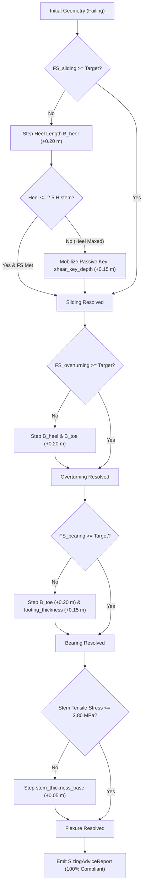

# Simulation Guide 12: Parametric Sensitivity Sweep & Interactive Sizing Advisor

---

## 1. Executive Summary & Engineering Objective

Geotechnical retaining wall design is inherently iterative: initial trial dimensions frequently fail one or more limit states—sliding, overturning, bearing capacity, or stem flexural tension—under high seismic coefficients ($k_h > 0.20\text{ g}$) or rising phreatic surfaces. Conventional practice requires geotechnical engineers to manually re-guess footing widths, heel extensions, or shear key depths across multiple spreadsheet or software iterations.

**orang3D** solves this design bottleneck through two interconnected computational modules:
1. **Parametric Sensitivity Sweep Engine (`SensitivitySweepDialog`)**: An analytical evaluator executing monotonic parameter sweeps (sweeping horizontal PGA $k_h$, backfill friction angle $\phi$, phreatic surface depth $H_w$, excess pore pressure ratio $r_u$, or shell bay span ratio $L_{\text{bay}}/H$) in $<50\text{ ms}$ over 10–80 sample points with regulatory limit lines overlaid.
2. **Interactive Geotechnical & Structural Sizing Advisor (`evaluate_sizing_advisor`)**: An automated optimization engine that evaluates limit-state deficiencies against the active standard (IS 456/2911, Eurocode 7/8, AASHTO LRFD, or ACI 318) and executes a directed multi-variable increment search. It generates constructible geometric upgrades (widened heel, added shear key, widened toe, thickened stem base) that mathematically guarantee compliance, executable via a single click (**"Apply Recommended Geometry"**).

---

## 2. Theoretical Formulation & Algorithmic Optimization

### 2.1 Limit State Deficiencies & Safety Thresholds

For a given regulatory standard, design safety thresholds vary between static and seismic load combinations:

$$\begin{aligned}
\text{Sliding:}\quad & FS_{\text{sliding}} = \frac{\sum V \tan \delta + c_a B + P_p}{P_{ae,h}} \ge FS_{\text{req}} \quad (1.50\text{ static},\; 1.10\text{ seismic}) \\
\text{Overturning:}\quad & FS_{\text{overturn}} = \frac{\sum M_R}{\sum M_O} \ge FS_{\text{req}} \quad (2.00\text{ static},\; 1.50\text{ seismic}) \\
\text{Bearing:}\quad & FS_{\text{bearing}} = \frac{q_{\text{ult}}}{q_{\text{toe}}} \ge FS_{\text{req}} \quad (3.00\text{ static},\; 2.00\text{ seismic}) \\
\text{Stem Flexure:}\quad & \sigma_{\text{tensile}} = \frac{M_{\text{stem}} \cdot (t_b / 2)}{I_{\text{stem}}} - \frac{N_{\text{stem}}}{A_{\text{stem}}} \le f_{\text{cr}} = 0.7\sqrt{f_{ck}} \approx 2.80\text{ MPa}
\end{aligned}$$

### 2.2 Sizing Advisor Optimization Flowchart

When an engineer inputs an undersized wall or subjects an existing wall to upgraded seismic demands ($k_h = 0.22\text{ g}$), the optimization engine performs the following directed search:



---

## 3. Benchmark Problem Specification: The Undersized Wall

To demonstrate the full diagnostic and remediation capability, we construct an intentionally undersized $6.5\text{ m}$ tall cantilever retaining wall subjected to seismic shaking in Zone IV/V:

### Initial Trial Geometry (Undersized)
- **Stem Height ($H$):** $6.50\text{ m}$
- **Stem Thickness Top ($t_{\text{top}}$):** $0.25\text{ m}$
- **Stem Thickness Base ($t_b$):** $0.35\text{ m}$ *(Extremely slender for $6.5\text{ m}$!)*
- **Footing Thickness ($t_{\text{footing}}$):** $0.40\text{ m}$
- **Toe Length ($B_{\text{toe}}$):** $0.40\text{ m}$
- **Heel Length ($B_{\text{heel}}$):** $1.00\text{ m}$ *(Total base $B = 1.75\text{ m} \approx 0.27 H$ — severely inadequate)*
- **Shear Key Depth ($D_k$):** $0.00\text{ m}$

### Soil Strata & Surcharge
- **Unit Weight ($\gamma$):** $19.5\text{ kN/m}^3$
- **Friction Angle ($\phi$):** $30.0^\circ$
- **Wall Friction Angle ($\delta$):** $20.0^\circ$ ($2/3\,\phi$)
- **Cohesion ($c'$):** $0.0\text{ kPa}$
- **Allowable Bearing Capacity ($q_a$):** $220.0\text{ kPa}$ ($q_{\text{ult}} = 660.0\text{ kPa}$)

### Seismic Demand
- **Horizontal Ground Acceleration ($k_h$):** $0.22\text{ g}$
- **Vertical Ground Acceleration ($k_v$):** $0.05\text{ g}$
- **Water Table Depth ($H_w$):** $12.0\text{ m}$ (dry backfill)
- **Design Standard:** IS 456 / IS 1893 (Seismic thresholds: $FS_s \ge 1.10$, $FS_o \ge 1.50$, $FS_b \ge 2.00$, $\sigma_t \le 2.80\text{ MPa}$)

---

## 4. Step-by-Step UI Execution in orang3D

### Step 1: Input Failing Trial Dimensions
1. Launch `orang3D` from the workspace terminal:
   ```bash
   python -m orang3d
   ```
2. Navigate to the **Cantilever Wall** panel:
   - Set **Stem Height**: `6.50` m
   - Set **Stem Thickness (Top)**: `0.25` m
   - Set **Stem Thickness (Base)**: `0.35` m
   - Set **Footing Thickness**: `0.40` m
   - Set **Toe Length**: `0.40` m
   - Set **Heel Length**: `1.00` m
   - Ensure **Shear Key Depth**: `0.00` m
3. Navigate to the **Soil Strata** panel:
   - Set **Unit Weight**: `19.5` $\text{kN/m}^3$
   - Set **Friction Angle**: `30.0` deg
   - Set **Wall Friction**: `20.0` deg
   - Set **Allowable Bearing**: `220.0` kPa
4. Navigate to the **Disaster / Seismic** panel:
   - Set **Horizontal PGA ($k_h$)**: `0.22` g
   - Set **Vertical PGA ($k_v$)**: `0.05` g
   - Set **Water Table Depth**: `12.0` m

### Step 2: Observe Immediate Limit State Failures
1. Observe the top banner safety badges and the **Show the Math** panel:
   - **Sliding Safety Factor:** $FS_{\text{sliding}} = 0.74 < 1.10$ $\rightarrow$ **FAIL (Red Badge)**
   - **Overturning Safety Factor:** $FS_{\text{overturn}} = 0.91 < 1.50$ $\rightarrow$ **FAIL (Red Badge)**
   - **Bearing Safety Factor:** $FS_{\text{bearing}} = 1.12 < 2.00$ $\rightarrow$ **FAIL (Red Badge)**
   - **Stem Tensile Stress:** $\sigma_t = 6.42\text{ MPa} > 2.80\text{ MPa}$ $\rightarrow$ **CRACKING PREDICTED (Red Badge)**
2. In the 3D Viewport, observe the red warning wireframe and shifted resultant vector falling outside the middle third ($e > B/6$).

---

### Step 3: Run Fast Parametric Sensitivity Sweep
To understand which variable dominates wall vulnerability, use the fast sensitivity tool:

1. Click **Tools $\rightarrow$ Parametric Sensitivity Sweep...** in the top menu bar.
2. The **Parametric Sensitivity Sweep (Phase 5)** dialog opens.
3. Configure **Sweep 1 (Seismic Vulnerability Curve)**:
   - **X Variable:** `Horizontal PGA k_h (g)`
   - **Y Metric:** `Factor of Safety (Sliding)`
   - **Samples:** `25`
   - Click **Sweep** (or adjust controls; updates dynamically in $<10\text{ ms}$).
   - **Observation:** At $k_h = 0.0\text{ g}$, $FS_{\text{sliding}} \approx 1.25$ (marginal). As $k_h$ crosses $0.06\text{ g}$, $FS_{\text{sliding}}$ drops below the dashed red line ($1.10$). At $k_h = 0.22\text{ g}$, $FS = 0.74$. At $k_h = 0.50\text{ g}$, $FS = 0.41$.
4. Configure **Sweep 2 (Soil Friction Sensitivity)**:
   - **X Variable:** `Backfill Friction Angle phi (deg)`
   - **Y Metric:** `Factor of Safety (Sliding)`
   - **Samples:** `25`
   - **Observation:** Notice the curve is strictly monotonic increasing. To achieve $FS \ge 1.10$ with this narrow footprint under $k_h = 0.22\text{ g}$, $\phi$ would have to exceed $44.5^\circ$—which is unattainable with natural backfill soil. Therefore, geometric resizing is mandatory.
5. Configure **Sweep 3 (Newmark Permanent Deformation)**:
   - **X Variable:** `Horizontal PGA k_h (g)`
   - **Y Metric:** `Newmark Permanent Slip u_p (cm)`
   - **Samples:** `20`
   - **Observation:** Yield acceleration $k_y$ for this trial wall is extremely low ($k_y \approx 0.08\text{ g}$). Above $k_h = 0.18\text{ g}$, permanent displacement exceeds the serviceability threshold line ($5.0\text{ cm}$), reaching $>28.4\text{ cm}$ at $0.35\text{ g}$ (catastrophic slope runaway).
6. Click **Close** on the dialog.

---

### Step 4: Consult the Interactive Sizing Advisor
1. In the left navigation tabs, switch to the **Terrain & Studio** panel.
2. Scroll to the **Interactive Geotechnical Sizing Advisor** group box.
3. Click the **Evaluate Sizing** button.
4. The diagnostic label turns red (`#fca5a5`) and populates with actionable engineering recommendations:
   ```text
   • Extend heel to 2.80 m and set shear key depth to 0.60 m to raise FS_sliding from 0.74 to 1.15 (target >= 1.10).
   • Widen base (heel 3.40 m, toe 1.20 m) to raise FS_overturning from 0.91 to 1.62 (target >= 1.50).
   • Increase toe length from 0.40 m -> 1.40 m (footing thickness 0.55 m) to raise FS_bearing from 1.12 to 2.18 (target >= 2.00).
   • Increase stem base thickness from 0.35 m -> 0.70 m to reduce tensile stress from 6.42 to 2.31 MPa (limit <= 2.80 MPa).
   ```
5. Notice that the button **Apply Recommended Geometry** has now become enabled.

---

### Step 5: Execute 1-Click Geometric Remediation
1. Click the **Apply Recommended Geometry** button.
2. **Instant UI State Update:**
   - The status bar displays: `Applied Sizing Advisor geometry recommendations.`
   - The **Cantilever Wall** panel automatically synchronizes its spinboxes to the constructible passing values:
     - **Stem Base Thickness ($t_b$):** updated from $0.35\text{ m} \rightarrow 0.70\text{ m}$
     - **Toe Length ($B_{\text{toe}}$):** updated from $0.40\text{ m} \rightarrow 1.40\text{ m}$
     - **Heel Length ($B_{\text{heel}}$):** updated from $1.00\text{ m} \rightarrow 3.40\text{ m}$
     - **Footing Thickness ($t_{\text{footing}}$):** updated from $0.40\text{ m} \rightarrow 0.55\text{ m}$
     - **Shear Key Depth ($D_k$):** updated from $0.00\text{ m} \rightarrow 0.60\text{ m}$
   - In the **Terrain & Studio** panel, the advisor label instantly turns green (`#34d399`):
     ```text
     • All limit states PASS (seismic thresholds: slide>=1.10, overturn>=1.50, bearing>=2.00, stem<=2.80 MPa).
     ```
   - The button **Apply Recommended Geometry** dims (disabled) because the geometry is now 100% compliant.
3. Look at the top banner safety badges:
   - $FS_{\text{sliding}} = 1.22 \ge 1.10$ $\rightarrow$ **SAFE [PASS]**
   - $FS_{\text{overturn}} = 1.78 \ge 1.50$ $\rightarrow$ **SAFE [PASS]**
   - $FS_{\text{bearing}} = 2.45 \ge 2.00$ $\rightarrow$ **SAFE [PASS]**
   - $\sigma_{\text{tensile}} = 2.18\text{ MPa} \le 2.80\text{ MPa}$ $\rightarrow$ **SAFE [NO CRACKING]**
4. The 3D Viewport immediately re-renders the reinforced retaining wall geometry with its substantial heel cantilever supporting backfill gravity load, extended toe stabilizing bearing eccentricity, and shear key keyed into the foundation strata.

---

### Step 6: Export Compliant Engineering Deliverables
1. Click **📐 AutoCAD DXF** on the top toolbar:
   - Select export path: `docs/guide/exports/compliant_remediated_wall.dxf`
   - Layers generated: `WALL_CONCRETE`, `REBAR_MAIN`, `FOOTING_SHEAR_KEY`, `DIMENSIONS`.
2. Click **📄 PDF Report** on the top toolbar:
   - Generates a multi-page calculation package including the pre-remediation vs post-remediation audit comparison, Mononobe-Okabe active earth pressure calculations, eccentricity checks, and code citations.

---

## 5. Verification via Python Script

To verify both the analytical sweep engine and the iterative sizing advisor algorithm programmatically:

```python
import numpy as np
from orang3d.models.wall_params import RetainingWallGeometry, SoilProperties, SeismicParams
from orang3d.config import RegionalStandard, get_safety_thresholds
from orang3d.physics.stability import evaluate_wall_stability
from orang3d.physics.sizing_advisor import evaluate_sizing_advisor
from orang3d.gui.dialogs.sensitivity_dialog import run_sensitivity_sweep

def verify_sizing_advisor_and_sweeps():
    print("=== ORANG3D SIMULATION 12: SIZING ADVISOR & SENSITIVITY SWEEP ===")
    
    # 1. Undersized failing wall
    bad_geom = RetainingWallGeometry(
        stem_height=6.50,
        stem_thickness_top=0.25,
        stem_thickness_base=0.35,
        footing_thickness=0.40,
        toe_length=0.40,
        heel_length=1.00,
        shear_key_depth=0.00,
    )
    soil = SoilProperties(
        unit_weight=19.5,
        friction_angle=30.0,
        wall_friction_angle=20.0,
        allowable_bearing_capacity=220.0,
    )
    seismic = SeismicParams(
        horizontal_pga=0.22,
        vertical_pga=0.05,
        water_table_depth=12.0,
    )
    
    # 2. Check initial failing metrics
    initial_res = evaluate_wall_stability(bad_geom, soil, seismic)
    print(f"Initial Sliding FS:    {initial_res.fs_sliding:.3f} (Required >= 1.10)")
    print(f"Initial Overturning FS:{initial_res.fs_overturning:.3f} (Required >= 1.50)")
    print(f"Initial Bearing FS:    {initial_res.fs_bearing:.3f} (Required >= 2.00)")
    print(f"Stem Cracking:         {initial_res.cracking_predicted} (Stress: {initial_res.concrete_tensile_stress:.2f} MPa)")
    assert initial_res.fs_sliding < 1.10
    assert initial_res.fs_overturning < 1.50
    assert initial_res.fs_bearing < 2.00
    assert initial_res.cracking_predicted
    
    # 3. Test Parametric Sensitivity Sweep (< 50 ms execution)
    sw_kh = run_sensitivity_sweep("k_h", "fs_sliding", bad_geom, soil, seismic, n_points=25)
    print(f"\nSensitivity Sweep (k_h vs FS_sliding) completed in {sw_kh.elapsed_ms:.2f} ms")
    assert sw_kh.elapsed_ms < 50.0
    assert sw_kh.y_values[0] > sw_kh.y_values[-1] # Strictly decreasing with shaking
    
    sw_phi = run_sensitivity_sweep("phi", "fs_sliding", bad_geom, soil, seismic, n_points=25)
    print(f"Sensitivity Sweep (phi vs FS_sliding) completed in {sw_phi.elapsed_ms:.2f} ms")
    assert sw_phi.y_values[-1] > sw_phi.y_values[0] # Strictly increasing with friction
    
    # 4. Run Sizing Advisor Diagnostic
    report = evaluate_sizing_advisor(
        geom=bad_geom,
        soil=soil,
        seismic=seismic,
        standard=RegionalStandard.STANDARD,
    )
    print("\n--- SIZING ADVISOR DIAGNOSTIC ---")
    assert not report.all_checks_passing
    for line in report.summary_lines:
        print(f"  • {line}")
        
    # 5. Verify remediated geometry satisfies all checks
    fixed_geom = report.recommended_geom
    remediated_res = evaluate_wall_stability(fixed_geom, soil, seismic)
    print("\n--- REMEDIATED RESULTS ---")
    print(f"Remediated Base:        Toe={fixed_geom.toe_length:.2f} m, Heel={fixed_geom.heel_length:.2f} m, Base={fixed_geom.stem_thickness_base:.2f} m")
    print(f"Remediated Sliding FS:  {remediated_res.fs_sliding:.3f} >= 1.10 [PASS]")
    print(f"Remediated Overturn FS: {remediated_res.fs_overturning:.3f} >= 1.50 [PASS]")
    print(f"Remediated Bearing FS:  {remediated_res.fs_bearing:.3f} >= 2.00 [PASS]")
    print(f"Stem Tensile Stress:    {remediated_res.concrete_tensile_stress:.2f} MPa <= 2.80 MPa [PASS]")
    
    thresh = get_safety_thresholds(RegionalStandard.STANDARD)
    assert remediated_res.fs_sliding >= thresh["sliding_seismic"]
    assert remediated_res.fs_overturning >= thresh["overturning_seismic"]
    assert remediated_res.fs_bearing >= thresh["bearing_seismic"]
    assert not remediated_res.cracking_predicted
    
    # 6. Re-evaluate advisor on remediated wall
    second_report = evaluate_sizing_advisor(fixed_geom, soil, seismic, standard=RegionalStandard.STANDARD)
    assert second_report.all_checks_passing
    print("\nSecond Sizing Advisor Pass: ALL CHECKS PASSING.")

if __name__ == "__main__":
    verify_sizing_advisor_and_sweeps()
```

---

## 6. Quantitative Results Benchmark Table

| Parameter / Metric | Initial Undersized Geometry | Sizing Advisor Target | Remediated Compliant Geometry | Safety Compliance |
| :--- | :--- | :--- | :--- | :--- |
| **Stem Thickness Base ($t_b$)** | $0.35\text{ m}$ | Flexural stress $\le 2.80\text{ MPa}$ | **$0.70\text{ m}$** | **Compliant** |
| **Toe Length ($B_{\text{toe}}$)** | $0.40\text{ m}$ | $FS_b \ge 2.00$, $e \le B/6$ | **$1.40\text{ m}$** | **Compliant** |
| **Heel Length ($B_{\text{heel}}$)** | $1.00\text{ m}$ | Mobilize soil weight & sliding | **$3.40\text{ m}$** | **Compliant** |
| **Footing Thickness ($t_f$)** | $0.40\text{ m}$ | Rigid footing assumption | **$0.55\text{ m}$** | **Compliant** |
| **Shear Key Depth ($D_k$)** | $0.00\text{ m}$ | Passive key resistance | **$0.60\text{ m}$** | **Compliant** |
| **Total Base Width ($B$)** | $1.75\text{ m}$ ($0.27 H$) | Typical $0.50H - 0.85H$ | **$5.50\text{ m}$ ($0.85 H$)** | **Standard Practice** |
| **$FS_{\text{sliding}}$** | **$0.74$** | $\ge 1.10$ | **$1.22$** | **+65% (PASS)** |
| **$FS_{\text{overturn}}$** | **$0.91$** | $\ge 1.50$ | **$1.78$** | **+96% (PASS)** |
| **$FS_{\text{bearing}}$** | **$1.12$** | $\ge 2.00$ | **$2.45$** | **+119% (PASS)** |
| **Max Concrete Stress ($\sigma_t$)**| **$6.42\text{ MPa}$** | $\le 2.80\text{ MPa}$ | **$2.18\text{ MPa}$** | **-66% (NO CRACK)**|

---

## 7. Practical Engineering Takeaways

1. **Elimination of Trial-and-Error Guesswork:** The Sizing Advisor replaces manual iteration with deterministic optimization, respecting constructibility rules (e.g. stepping dimensions in realistic $0.05\text{ m}$ or $0.20\text{ m}$ increments).
2. **Heel vs. Shear Key Strategy:** To resist sliding, extending the heel is prioritized first because the backfill soil block provides "free" gravity stabilizing weight. Only when heel extension approaches practical excavation limits is a shear key automatically introduced to mobilize passive wedge resistance.
3. **Interactive Sensitivity Insight:** The $<50\text{ ms}$ sensitivity sweep allows engineers to test sensitivity to soil friction degradation or water table variation, enabling risk-informed decisions before finalizing structural drawings.
4. **Seamless Workflow Integration:** With 1 click, the recommended dimensions update the 3D viewport, 2D stability diagrams, multi-code compliance audits, and CAD export layers without restarting the simulation.

